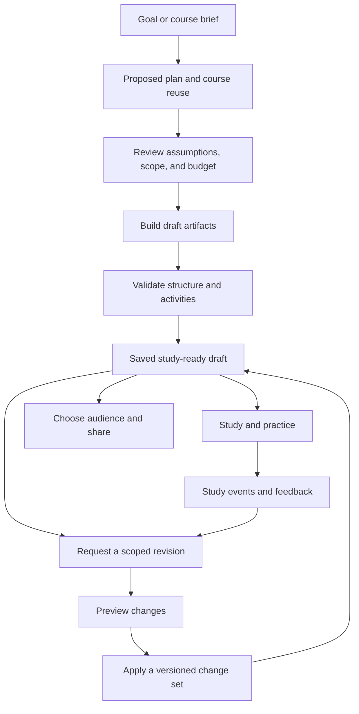

# Proposal: one AI workspace for a learning goal

Status: **proposed direction**, based on the owner's 2026-10-25 request and the [live journey audit](audits/2026-10-25/README.md). This is a design starting point, not implemented functionality or a commitment to a particular agent framework.

## The intended experience

The owner chose **one workspace that can plan and revise paths, courses, and modules**, starting from either a learning goal or one course idea. AI should turn a small brief into usable learning material and support later refactoring. Direct manual editing remains available in that workspace.

Example brief:

> Help me become a senior software engineer. I know Python, can study four hours a week, and learn best by practicing. Propose a path, reuse suitable courses, and build the missing lessons with cards, quizzes, and exercises.

The same workspace could start with “Build a beginner course on storyboarding.” Scope changes; planning, generation, review, and study use the same machinery.

The first useful outcome is a **validated, saved, study-ready module**, with a visible plan for the rest. The user should not need to save an empty course, leave the flow, reopen an editor, and find separate generation buttons before useful work begins.

## What the audit changes

| Current observation | Proposed replacement |
| --- | --- |
| A course must be saved before AI suggestions are available. | Autosave a private workspace brief/draft and plan in place. |
| Purpose, audience, objectives, and tone require separate manual entries. | Start with a goal and useful constraints; infer an editable brief, show assumptions, and ask only questions that materially change the plan. |
| Course and path creation are separate editors. | One goal map contains the path, reused courses, ordered modules, and activities. A single course is the smaller scope of that map. |
| One large generation response fails parsing; credits are spent and no module is saved. | Generate bounded artifacts with validation, saved outcomes, recovery, and explicit cost rules. |
| Outline batch creation can lose/corrupt data. | Commit validated change sets atomically and persist job/revision state. |
| Regeneration offers append/replace; replacement deletes existing modules first. | Make scoped revisions with a preview, preservation rules, version history, and undo. |
| Progress, history, path selection, and reuse have inconsistent meanings. | Define durable events and membership records, then derive the metrics from them. |
| Pages, progress, and generation apply different permissions. | Every tool checks the requesting user's rights before reading context, generating, or writing. |

## The main workflow

1. **Describe the outcome.** Enter a learning goal or course idea. Optionally add prior knowledge, audience, available time, target date, learning preferences, and trusted sources. AI proposes missing defaults as editable assumptions.
2. **Review a plan.** AI proposes the path/course/module structure, objectives, prerequisites, effort, reusable courses, and activities. Accept, edit, or ask for a different plan in place.
3. **Build a useful draft.** Prepare the first module, then continue within the chosen budget. Show completed artifacts, current phase, errors, and remaining work. A ready module can be studied while independent generation continues.
4. **Refine.** Requests such as “make module two more practical,” “split this lesson,” or “shorten the path to six weeks” become scoped proposed changes. Show what changes and what is preserved.
5. **Apply and share deliberately.** Save content revisions with history. Sharing/publication is a separate choice of audience and permissions; generating content does not make a draft public.
6. **Study.** Present content, cards, quizzes, and practice with a clear next step through the selected path. Use deterministic scores and execution results where available.
7. **Learn from feedback.** Propose targeted explanations, practice, or plan revisions from actual study events and learner feedback. Let the learner keep the current plan or apply a proposed change.

## What the harness owns

Here, the harness is the application machinery around the model: a goal contract, retained context, bounded tools, execution state, validation, permissions, and feedback. It makes generated work reliable enough to become course content and personal learning history.

| Capability | Responsibility |
| --- | --- |
| Task contract | Store goal, audience, prior knowledge, constraints, source policy, activity preferences, and completion criteria as a structured brief. Do not rely on an ever-growing chat transcript as the only specification. |
| Context/state | Retain approved plans, resource references, learner preferences, sources, revisions, protected manual edits, and outstanding decisions. Authoring context and private learner state have separate access rules. |
| Planner | Propose a path/course and dependencies, identify reuse, and expose assumptions as an editable artifact. |
| Tools | Offer bounded typed read/create/update/reorder/generate operations. The server enforces access, ownership, versions, budgets, and allowed effects for every operation. |
| Execution loop | Plan → bounded operation → execute → validate → persist outcome → continue or request a relevant decision. Parallel work requires safe persistence and budget coordination. |
| Durable jobs | Persist job IDs, steps, attempts, artifact references, errors, usage, and timestamps. Reload/reconnect restores status and can resume without repeating successful work. |
| Validation/repair | Check schemas, required fields, requested counts, answer indices, references, objective coverage, and runnable examples. Bound repair attempts and retain prior valid results. |
| Revisions | Apply a change set against a known revision; preview a diff, detect conflicts, preserve history, and support undo. Reusing a course never grants permission to rewrite its author's source. |
| Feedback | Use explicit learner feedback and durable study events for targeted suggestions. Distinguish model judgments from deterministic scoring and observed performance. |
| Models | Default to Anvil. Support available Anvil routes and user-configured external providers. Expose the selected model/capabilities; do not silently send material to a different provider. |
| Cost/observability | Show phase, progress, model, estimated/actual usage, validation, and recovery. Define failure/cancellation billing and idempotency before claiming safe/free retries. |

The model cannot grant its own authorization, read another user's private material, guess a known multiple-choice score, or treat generated prose as proof that code runs correctly.

## Initial tool contracts

These are application tools, not arbitrary shell access for an agent.

| Group | Operations | Constraints |
| --- | --- | --- |
| Inspect | Read brief, authorized courses/modules/catalog/path membership, own progress, model capabilities. | Resource checks precede reads; private sources cannot enter an unauthorized generation prompt. |
| Plan | Propose a path, suggest course reuse/outline, map objectives to activities. | Structured proposals, references, assumptions; no publication side effect. |
| Author | Create draft course/module, update content/cards/questions/practice, reorder, split/merge. | Typed patches, revision checks, ownership, validation, atomic change sets. |
| Generate | Produce a section, deck, quiz, practice exercise, or visual where a capable model is configured. | Bounded sizes, selected provider, per-operation budget, retained output/errors, validated structure. |
| Verify | Check artifacts/answer keys/counts, run examples in the bounded sandbox, assess objective coverage. | Deterministic checks when possible; teaching-quality judgments stay reviewable. |
| Revise | Propose a scoped change, compare versions, apply a change set, undo. | Preserve excluded/manual content and other authors' material; detect conflicts. |
| Study | Record events, submit known-answer quiz scores, show next step/history. | Personal state belongs to the learner; event and completion definitions are explicit. |
| Share | Prepare audience changes, identify unavailable dependencies, apply a user-chosen audience. | Permissions stay separate from generation; course/path access are independently enforced. |

Source-document ingestion, broad web research, and non-code practice are possible later capabilities. They need their own source-quality, access, and activity contracts; they are not prerequisites for the first complete loop.

## Persistent artifacts and lifecycle

Keep the useful course/module/path objects. Proposed additions:

- **Workspace/brief:** goal, scope, constraints, preferences/models, approved assumptions, and references.
- **Plan revision:** structured path/course/module plan, objectives, prerequisites, reuse, and application status.
- **Job/step:** state, inputs/resource versions, model, attempt/idempotency key, timestamps, usage, output/error references, and validation results.
- **Artifact revision/change set:** content, sources, parent revision, targeted edits/diff, author, and applied/undone status.
- **Study event/session and path selection:** durable personal history and adoption records, separate from aggregate progress summaries.

Proposed lifecycle: `draft → planned → running → validating → ready`, with explicit `waiting for review`, `partial`, `failed`, and `cancelled` states. Recovery uses persisted step outcomes. A client disconnect must not lose job state or repeat successful calls. Cancellation stops new work and explains any provider call already in progress or charge already incurred.

Start with one orchestrator, bounded tools, and validators. Introduce specialist agents only if measured failures justify them; the architecture does not require an agent team.

## Refactoring examples

| Request | Expected behavior |
| --- | --- |
| “Make module two easier and add practical examples.” | Revise that explanation/examples; propose related activity updates; preserve other modules. |
| “Split this into shorter lessons.” | Propose boundaries/order, redistribute activities, explain progress consequences, apply one versioned change set. |
| “Keep the course, replace only the quiz.” | Retain content/cards/practice, validate the new quiz, preserve the prior revision and attempt history. |
| “Use this course in my senior engineer path.” | Add an authorized reference with original authorship; do not rewrite the source or inflate counts on duplicate add. |
| “Retry the broken module only.” | Retry that step using the current brief/revision, retain successful work, show incremental usage. |
| “Undo the last AI change.” | Restore the applicable prior revision and describe affected artifacts, with a retained audit trail. |

## Reuse the current foundation

The [study viewer](../frontend/src/pages/ModuleViewer.tsx), activity models, execution surfaces, course/path references, and standalone generation operations are useful. The [course orchestrator](../backend/services/course_orchestrator.py) and [full-course endpoint](../backend/api/routes/generation.py#L128) already describe a multi-phase pipeline. That endpoint was not exercised in this audit; its performance comments are not measurements.

Build on these pieces while replacing fragmented creation. Resolve data races and inconsistent access before increasing concurrency or editing capability.

## Delivery sequence

1. **Repair the foundation.** Consistent permissions, account cache isolation, atomic persistence, structured responses/recovery/billing, and study-event history. Add meaningful browser/API regressions for reproduced defects. Correct author controls and keyboard interactions.
2. **Deliver one complete course loop.** From a brief, plan a small course, build a study-ready module with activities, validate it, request one scoped revision, apply/undo it, and resume after reload. Start with Anvil and keep the manual editor on the same artifacts.
3. **Extend to paths and reuse.** Build paths from goals, connect courses, create missing material, guide study across courses, and support explicit following/sharing. Explain unavailable dependencies and useful contribution counts.
4. **Add model choice and feedback.** User preferences and server-protected BYOK, capability/error handling, event-based stats, and targeted explain/practice/replan suggestions that preserve prior progress.
5. **Choose the identity and relaunch.** Set positioning/name around the working goal-to-learning experience; update identity, onboarding, docs, and release communication. Run the 40 baseline journeys plus new workspace/revision/recovery scenarios. This proposal selects no name and changes no repository/package identity.

First-loop acceptance: a clean account reaches useful material without the empty-course/reopen detour; errors leave recoverable work; model/usage are visible; unauthorized context cannot be used; a scoped revision preserves unrelated content.

## Measures and open decisions

Use the same brief/fixtures for a controlled manual-versus-AI comparison. Measure time to a validated saved study-ready module, active input/provider wait separately, required fields/navigation transitions, valid persisted output rate, first-attempt/repaired success, revision time/cost, and successful resume/retry/undo without duplicate work or charges. Assess actual learning outcomes over time.

Do not infer a speedup from this audit's prewritten tiny fixtures or overlapping inspection times. Establish a repeatable baseline and targets before making a relaunch claim.

The unified workspace and default Anvil route are chosen. Remaining decisions include the first audience/practice types, trusted sources, sharing/collaboration permissions, reused-content versioning, session/streak definitions, model catalogs/authentication (including what “Codex” means), credit rules, and the new name. See the [catalog's policy table](user-journeys.md#policies-to-settle-before-implementing-dependent-tests).

Resolve these during design of the first complete loop. The entire overhaul need not be implemented before validating whether that new creation experience helps people.
