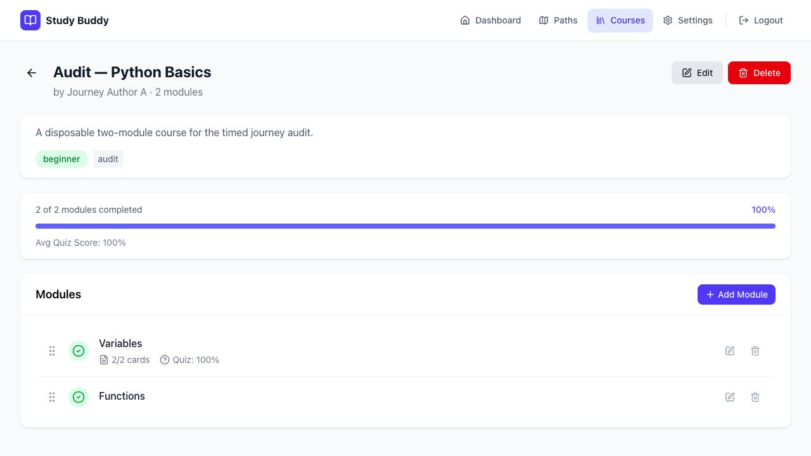
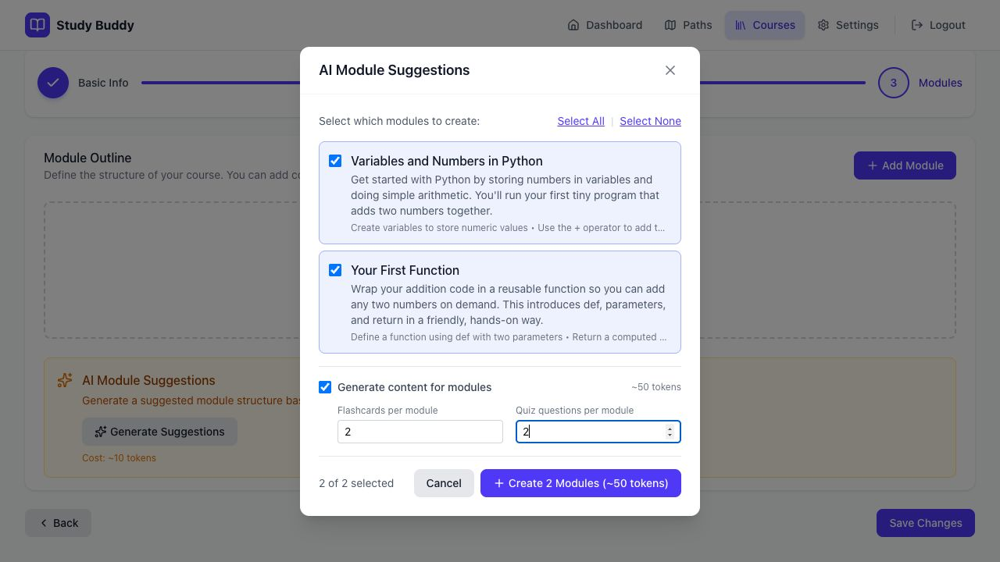
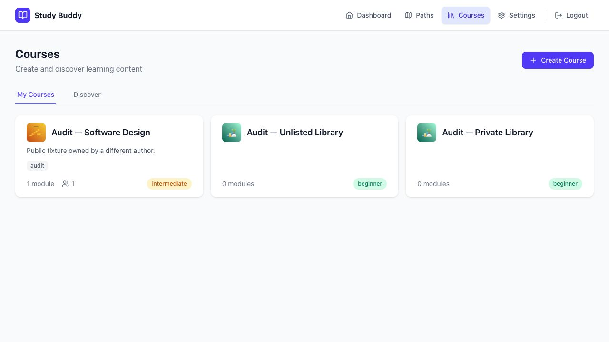
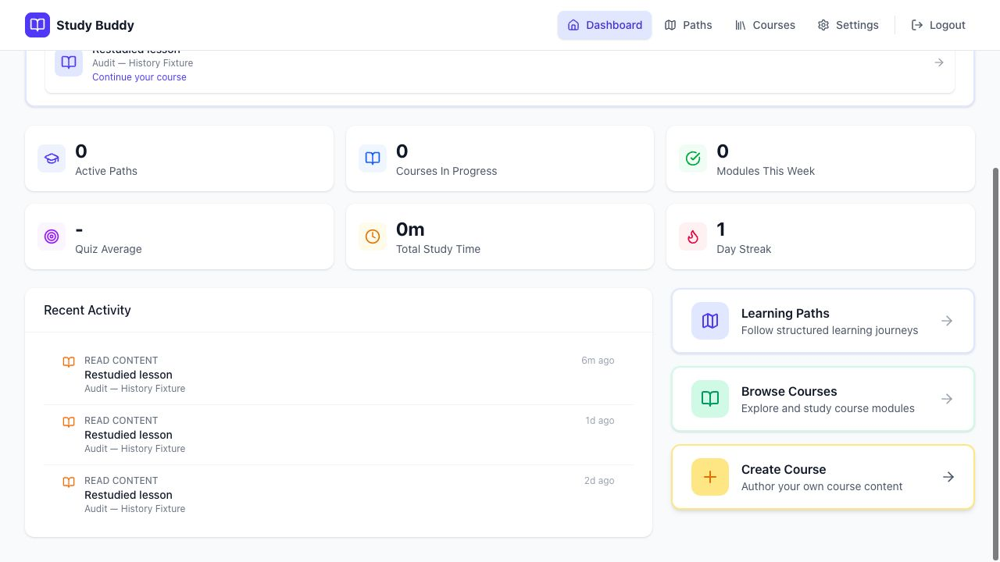
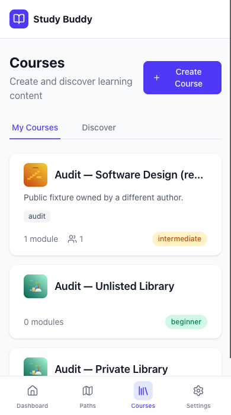
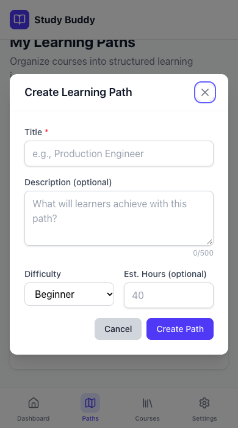

# Study Buddy: timed user-journey walkthrough

Audit date: **2026-10-25, America/Los_Angeles** (2026-10-26 UTC). Scope: all **40 journeys** in the [acceptance catalog](../../user-journeys.md), followed by an [AI workspace proposal](../../ai-workspace-proposal.md).

## Result

| Outcome | Journeys | Meaning |
| --- | ---: | --- |
| Completed | 19 | The main scenario exercised could be finished and its outcome checked. This does not pass every catalog branch. |
| Partial | 8 | Some behavior works, but the full journey is incomplete or has a material issue. |
| Blocked | 8 | A required UI entry point/feature is absent; completion time is unavailable. |
| Failed | 5 | An available flow reproduced a functional or access/isolation failure. |

The manual authoring and study loop is usable. Combined AI creation, batch data consistency, and account/content isolation need work before relaunch. Standalone AI flashcard and quiz generation succeeded. Sharing audiences, following paths, weekly study sessions, and user model/provider choice cannot currently be completed through the UI.

## Environment, method, and timing limits

- Frontend: `http://127.0.0.1:5174`; backend: `http://127.0.0.1:8011`. The source includes the earlier uncommitted journey fixes.
- The frontend ran from a temporary source copy with a fresh install from the existing lockfile. The checkout initially produced a Vite/Babel error: its installed `caniuse-lite` agents module exported no agents. [Screenshot 00](screenshots/00-environment-startup-error.png) records this setup interruption, excluded from journey timings. The fresh install resolved it; the underlying dependency failure was not diagnosed further.
- Separate JSON storage: `/tmp/study-buddy-audit-20261025/data`. The normal port-5173 app and its account/content storage were not used for mutations. Created/deleted content and accounts are synthetic fixtures.
- Browser: Codex in-app browser through CUA, fresh accessibility-state checks, saved screenshots, desktop 1280×720, and mobile 390×700 CSS pixels. Mobile emulation used CUA's CDP capability and was cleared afterward. An initial taller screenshot exceeded the native viewport and was rejected/replaced.
- API/storage reads supplement UI evidence. API-created public/private fixtures and seeded historical events are identified; they do not count as successful UI sharing or three days of live study.
- Real Anvil `llm.primary` handled generation. No real email/SMS was sent and no personal external-provider key was entered.
- **Wall time** runs from the first timed action to the recorded outcome. It includes inspection, troubleshooting, and sometimes another independent check while AI runs. Journeys overlap/share fixtures: do not add these times or treat them as human usability benchmarks.
- **Browser time** is the rounded sum of instrumented browser action/state-check calls during that interval. It excludes most operator thinking, fixture preparation, and independently observed model waits. `<1s` means a rounded sub-second observation, never instant completion of a missing feature.
- Tiny lessons and inputs were prewritten. Study timings measure interaction/persistence, not learning/comprehension time. Blocked journeys have **N/A completion time**; only inspection was timed.

The [walkthrough log](walkthrough-log.json), [CSV](journey-results.csv), [secondary API checks](secondary-checks.json), [console observations](console-observations.json), and [run manifest](run-manifest.json) accompany this report. This is a live walkthrough, not a new automated browser suite. Prior unit-test results are not presented as results from this run.

## Findings

### F01 — Private content reaches generation/progress through inconsistent access checks

**Release blocker.** B's direct requests for A's private course, module, and module list returned 404. But private course progress returned 200, and generating cards from A's private AI module returned one card with HTTP 200, charging B eight credits. Only synthetic private content was used.

[Generation routes](../../../backend/api/routes/generation.py) require login, but [resource lookup](../../../backend/services/ai_generation_service.py#L270) reads course/module storage without checking the requesting user's access. [Course progress](../../../backend/services/progress_service.py#L154) also returns private course/module metadata through a separate read path. Evidence: [API checks](secondary-checks.json), AUTH-03, and [correctly denied lesson](screenshots/43-private-module-access-denied.png).

Required: one resource-access policy enforced before returning metadata or calling a model; multi-account regressions for nested resources, progress, generation, and paths.

### F02 — Account switching exposes the previous account's cached private course list

**Release blocker.** Populate B's My Courses, sign out, sign in as A without reloading, then open My Courses. B's private/unlisted cards remain visible. A's Settings confirms A's identity. Reload fetches A's correct courses.

Evidence: [cached list](screenshots/40-cross-account-cached-private-courses.png), [A's identity](screenshots/41-current-account-identity.png), [after reload](screenshots/42-courses-after-cache-clearing-reload.png). [Query keys](../../../frontend/src/hooks/useCourses.ts#L16) lack account identity; [logout](../../../frontend/src/hooks/useAuth.ts#L122) clears auth state/token without clearing the application query cache.

Required: account-scoped caches and cleanup/cancellation on account change, including already-open tabs.

### F03 — Outline batch creation loses a module and corrupts JSON storage

**Release blocker for JSON storage.** Outline-only creation reports two modules created. Stored JSON contained one new module and 12 trailing bytes after the valid JSON object. Later module reads returned 500 with `Extra data`; Save Changes failed.

[Batch storage](../../../backend/storage/base.py#L94) calls `create()` concurrently; [JSON storage](../../../backend/storage/json_storage.py#L21) reads/rewrites the entire collection without coordinating writers or atomic replacement. The observed lost update and invalid file are consistent with that race. The [module batch service](../../../backend/services/module_service.py#L116) uses this inherited operation.

The corrupt test file was preserved outside the repository. Its valid prefix recovered the three original modules and one new outline. The missing outline was recreated as an API fixture with a short manually supplied lesson; later standalone AI tests used that restored fixture. This repaired test data, not product code, and does not pass the failed batch journey.

Required: atomic batch writes that preserve every item, meaningful concurrent-write regressions, and transactional persistence for durable generation jobs.

### F04 — Full AI generation fails but consumes 50 credits

**High impact.** Anvil returned a relevant two-module plan. Both full-content requests then returned 503: one response had an unterminated JSON string; another was empty/invalid JSON. Zero modules were saved. Balance moved 100 → 90 after planning → 40 after two failed module attempts. The batch's last failure arrived about **80 seconds** after starting it; the longer journey time includes investigation/independent checks.

[Generation](../../../backend/services/ai_generation_service.py#L479) consumes credits before parsing/validation. Its prompt requests 1500–3000 words plus activities in one JSON response. The exact model-side failure cause was not established; truncation/budget pressure is a hypothesis. Standalone cards/quiz later succeeded, so this is not a blanket connectivity failure.

At a later balance of 22, Generate All (25) was rejected and preserved the draft, but showed only a generic retry error. [Client error parsing](../../../frontend/src/api/client.ts) reads `detail`, while the backend uses a structured error envelope.

Evidence: [generation selection](screenshots/26-ai-plan-with-default-generation.png), [no saved modules](screenshots/29-ai-generation-no-saved-modules.png), [balance after failures](screenshots/28-notification-preferences.png), [credit-limit feedback](screenshots/38-insufficient-token-error.png).

Required: bounded generated artifacts, structured validation, retained outcomes, explicit retry/recovery, and transparent failure billing/refund rules.

### F05 — Repeated study of one module loses streak history

**Stats accuracy failure.** A controlled fixture has study events on three consecutive dates for one module. Recent Activity shows all three days; Current Streak and Longest Streak show 1.

[Calculation](../../../backend/services/progress_service.py#L564) uses each module-progress record's latest update date, which cannot retain every study day. Evidence: [widgets](screenshots/53-historical-streak-undercount.png), [three-day history](screenshots/54-three-day-study-history.png), [API result](secondary-checks.json). History was seeded, not studied live over three days.

Required: durable qualifying study events and a defined timezone/day policy; tests for repeated study, gaps, midnight, and historical maxima.

### F06 — Personal metrics differ from the requested meanings

A read-started course appears in Continue Learning while Courses In Progress is 0: the count requires a completed-module percentage above zero. Active Paths counts partially completed owned paths, not selected paths. Modules This Week counts completions, not sessions. Exercised study left Total Study Time at 0m.

Evidence: [Dashboard](screenshots/31-dashboard-counts.png), STATS-01/STATS-03, [stats service](../../../backend/services/progress_service.py#L320). Define sessions, selected paths, active courses, time measurement, and timezone before automating those assertions.

### F07 — Reorder grips and author controls are misleading

Dragging a path grip has no effect and there is no accessible reorder action, although a backend endpoint exists. Non-owners see Edit/Delete/Add Module controls on shared database content; attempted course saves are rejected with a generic error.

[Path detail](../../../frontend/src/pages/LearningPathDetail.tsx) renders a grip without a reorder interaction. [Course detail](../../../frontend/src/pages/CourseDetail.tsx#L107) and [viewer](../../../frontend/src/pages/ModuleViewer.tsx#L187) decide editability from storage source rather than ownership. Evidence: [path](screenshots/19-path-two-courses.png), [non-owner editor](screenshots/35-non-owner-editor-error.png), [non-owner path](screenshots/44-shared-path-silently-missing-course.png).

### F08 — Inaccessible courses disappear silently from shared paths

A public path fixture has two references; B sees one course and a one-course header because A's private course is omitted. No unavailable-course warning explains the incomplete goal. Renaming an accessible course correctly updates the live reference after refresh.

Evidence: [missing course](screenshots/44-shared-path-silently-missing-course.png), [rename](screenshots/45-live-course-reference-renamed.png), [raw/visible counts](secondary-checks.json). The [path response](../../../backend/api/routes/learning_paths.py) skips inaccessible/erroring courses. Visibility was an API fixture because sharing controls are absent.

### F09 — Sharing, path adoption, and model choice lack UI flows

No audience control, named-recipient/grant/revocation control, shared-path discovery/follow action, or user provider/model/key picker was found. See SHARE-01–03, PATH-04, AI-02–04, [course editor](screenshots/39-course-no-sharing-controls.png), [path editor](screenshots/21-path-edit-no-sharing.png), [Paths](screenshots/22-paths-no-follow.png), and [Settings](screenshots/27-settings-default-anvil.png).

Missing capabilities are blockers, not passes with completion times of zero seconds.

### F10 — Reuse counts persist but remain stale and ambiguous

Adding another path changes the persisted count 1 → 2; deleting that path returns 2 → 1 and preserves the source course. The author card stayed at 1 until reload after adding. The people icon/number does not explain path references, own-path inclusion, or adoption by others. There is no contribution analytics view.

Evidence: [stale](screenshots/46-reuse-count-stale-before-reload.png), [reloaded](screenshots/47-author-reuse-count-after-reload.png), [after deletion](screenshots/48-author-reuse-count-after-delete.png). [Membership hooks](../../../frontend/src/hooks/useLearningPaths.ts) invalidate discovery but not the owned-course list. Concurrent reconciliation was not tested.

### F11 — Invalid phone text is saved; toggle states are not announced

`invalid-phone` was accepted/persisted and enabled Test SMS. It was then replaced with a synthetic valid-format number; no message was sent. [Phone fields](../../../backend/models/notification.py) are plain optional strings. Toggle buttons expose labels but no checked/pressed state in the observed accessibility tree. See SUPPORT-01, stored-state verification, and [Settings](screenshots/28-notification-preferences.png).

### F12 — Admin denial floods the UI with repeated toasts

Opening `/admin` as an ordinary user redirects away but emits many duplicate denial toasts; a generic error view also appeared. Evidence: [screenshot 36](screenshots/36-admin-access-toast-flood.png). [The admin access effect](../../../frontend/src/pages/admin/AdminDashboard.tsx#L29) is the entry point; the repetition mechanism/accompanying request failure needs focused investigation. No fix was implemented.

### F13 — AI outline descriptions are discarded

Suggestions included descriptions/objectives; outline-only creation left blank descriptions. [Suggestion creation](../../../frontend/src/hooks/useModuleSuggestions.ts) omits descriptions from module data and supplies empty outline descriptions. Evidence: [suggestions](screenshots/26-ai-plan-with-default-generation.png), [blank fields](screenshots/30-ai-outline-save-failed.png).

**Source-reviewed risk, not executed:** Replace All deletes existing modules before replacement generation succeeds. Failure could remove existing work. Require a transactional/versioned replacement regression before increasing AI autonomy.

### F14 — Core controls have keyboard/assistive-technology risks

Card flipping and answer-key selection use clickable containers rather than semantic keyboard controls. Notification toggles lack announced state; some generation controls have weak accessible labels. Mobile library/settings/dialog checks were usable; Escape restored focus. This is not full accessibility conformance testing. See SUPPORT-02, [cards](../../../frontend/src/pages/ModuleViewer.tsx#L394), [answer keys](../../../frontend/src/components/module-editor/QuizQuestionItem.tsx#L64), and mobile evidence.

## All 40 journey results

The ID opens actual executed steps. Times follow the method above; blocked completion is N/A even if inspection took under one second.

| ID | Journey | Outcome | Can finish? | Wall observation | Browser calls | Findings |
| --- | --- | --- | --- | ---: | ---: | --- |
| [AUTH-01](#auth-01) | Create an account | Completed | Yes, exercised case | 9s | 1s | — |
| [AUTH-02](#auth-02) | Sign in, resume a session, and sign out | Failed | No: reproduced failure | 1m 10s | 3s | [F02](#f02--account-switching-exposes-the-previous-accounts-cached-private-course-list) |
| [AUTH-03](#auth-03) | Respect ownership and isolate learner data | Failed | No: reproduced failure | 6m 01s | 7s | [F01](#f01--private-content-reaches-generationprogress-through-inconsistent-access-checks), [F02](#f02--account-switching-exposes-the-previous-accounts-cached-private-course-list), [F07](#f07--reorder-grips-and-author-controls-are-misleading), [F12](#f12--admin-denial-floods-the-ui-with-repeated-toasts) |
| [COURSE-01](#course-01) | Create a manual course with module outlines | Completed | Yes, exercised case | 33s | 4s | — |
| [COURSE-02](#course-02) | Maintain an existing course's outline | Completed | Yes, exercised case | 33s | 3s | — |
| [COURSE-03](#course-03) | Edit course details and delete an owned course | Completed | Yes, exercised case | 36s | 3s | — |
| [COURSE-04](#course-04) | Discover and open accessible courses | Completed | Yes, exercised case | 29s | 2s | — |
| [COURSE-05](#course-05) | Plan a course with AI assistance | Failed | No: reproduced failure | 7m 50s | 9s | [F03](#f03--outline-batch-creation-loses-a-module-and-corrupts-json-storage), [F04](#f04--full-ai-generation-fails-but-consumes-50-credits), [F13](#f13--ai-outline-descriptions-are-discarded) |
| [MODULE-01](#module-01) | Write and maintain lesson content | Completed | Yes, exercised case | 28s | 4s | — |
| [MODULE-02](#module-02) | Author a flashcard deck inside a module | Completed | Yes, exercised case | 12s | 2s | [F14](#f14--core-controls-have-keyboardassistive-technology-risks) |
| [MODULE-03](#module-03) | Author a quiz and answer key | Completed | Yes, exercised case | 22s | 2s | [F14](#f14--core-controls-have-keyboardassistive-technology-risks) |
| [MODULE-04](#module-04) | Configure and remove practice | Completed | Yes, exercised case | 58s | 5s | — |
| [MODULE-05](#module-05) | Generate and refine module activities with AI | Partial | Partly | 2m 58s | 8s | [F04](#f04--full-ai-generation-fails-but-consumes-50-credits) |
| [STUDY-01](#study-01) | Read a lesson and run embedded examples | Completed | Yes, exercised case | 44s | 1s | — |
| [STUDY-02](#study-02) | Review every flashcard, including the last | Completed | Yes, exercised case | 13s | 1s | [F14](#f14--core-controls-have-keyboardassistive-technology-risks) |
| [STUDY-03](#study-03) | Rate cards and focus on difficulty | Completed | Yes, exercised case | 31s | 2s | — |
| [STUDY-04](#study-04) | Take a quiz, learn from mistakes, and retry | Completed | Yes, exercised case | 45s | 2s | — |
| [STUDY-05](#study-05) | Practice with starter code, feedback, and a solution | Completed | Yes, exercised case | 13s | 2s | — |
| [STUDY-06](#study-06) | Complete modules and resume the course | Completed | Yes, exercised case | 17s | 1s | — |
| [PATH-01](#path-01) | Create and edit a goal-based path | Completed | Yes, exercised case | 24s | 2s | — |
| [PATH-02](#path-02) | Build a path from existing courses | Completed | Yes, exercised case | 45s | 2s | — |
| [PATH-03](#path-03) | Reorder, remove courses, and delete a path | Partial | Partly | 50s | 3s | [F07](#f07--reorder-grips-and-author-controls-are-misleading) |
| [PATH-04](#path-04) | Select and follow someone else's path | Blocked | No: UI missing | <1s inspection | <1s | [F09](#f09--sharing-path-adoption-and-model-choice-lack-ui-flows) |
| [PATH-05](#path-05) | Learn through a path and keep summaries accurate | Partial | Partly | 31s | 2s | [F08](#f08--inaccessible-courses-disappear-silently-from-shared-paths), [F09](#f09--sharing-path-adoption-and-model-choice-lack-ui-flows) |
| [SHARE-01](#share-01) | Choose course visibility and let another user study it | Blocked | No: UI missing | <1s inspection | <1s | [F09](#f09--sharing-path-adoption-and-model-choice-lack-ui-flows) |
| [SHARE-02](#share-02) | Share a course with specific people and revoke access | Blocked | No: UI missing | <1s inspection | <1s | [F09](#f09--sharing-path-adoption-and-model-choice-lack-ui-flows) |
| [SHARE-03](#share-03) | Share a learning path inside the product | Blocked | No: UI missing | <1s inspection | <1s | [F08](#f08--inaccessible-courses-disappear-silently-from-shared-paths), [F09](#f09--sharing-path-adoption-and-model-choice-lack-ui-flows) |
| [SHARE-04](#share-04) | Handle edits, deletion, and revoked course access in reused paths | Partial | Partly | 55s | 2s | [F01](#f01--private-content-reaches-generationprogress-through-inconsistent-access-checks), [F08](#f08--inaccessible-courses-disappear-silently-from-shared-paths) |
| [SHARE-05](#share-05) | Show authors how useful their courses are | Partial | Partly | 55s | 4s | [F10](#f10--reuse-counts-persist-but-remain-stale-and-ambiguous) |
| [STATS-01](#stats-01) | See how often I studied in the last week | Blocked | No: UI missing | <1s inspection | <1s | [F06](#f06--personal-metrics-differ-from-the-requested-meanings) |
| [STATS-02](#stats-02) | Maintain current and longest study streaks | Failed | No: reproduced failure | 16s | 1s | [F05](#f05--repeated-study-of-one-module-loses-streak-history) |
| [STATS-03](#stats-03) | See courses in progress and paths I selected | Partial | Partly | 12s | 1s | [F06](#f06--personal-metrics-differ-from-the-requested-meanings) |
| [STATS-04](#stats-04) | See activity and progress that survive navigation | Completed | Yes, exercised case | 1s | <1s | — |
| [AI-01](#ai-01) | Use Anvil by default without a personal key | Completed | Yes, exercised case | 28s | <1s | — |
| [AI-02](#ai-02) | Choose among available Anvil models | Blocked | No: UI missing | <1s inspection | <1s | [F09](#f09--sharing-path-adoption-and-model-choice-lack-ui-flows) |
| [AI-03](#ai-03) | Bring a key and choose an external provider/model | Blocked | No: UI missing | <1s inspection | <1s | [F09](#f09--sharing-path-adoption-and-model-choice-lack-ui-flows) |
| [AI-04](#ai-04) | Replace or remove my provider credential and return to Anvil | Blocked | No: UI missing | <1s inspection | <1s | [F09](#f09--sharing-path-adoption-and-model-choice-lack-ui-flows) |
| [AI-05](#ai-05) | Handle generation errors, limits, and provider changes | Failed | No: reproduced failure | 6m 23s | 6s | [F04](#f04--full-ai-generation-fails-but-consumes-50-credits) |
| [SUPPORT-01](#support-01) | Set notification preferences | Partial | Partly | 1m 15s | 1s | [F11](#f11--invalid-phone-text-is-saved-toggle-states-are-not-announced), [F14](#f14--core-controls-have-keyboardassistive-technology-risks) |
| [SUPPORT-02](#support-02) | Navigate, recover from errors, and use the app on mobile/keyboard | Partial | Partly | 1m 51s | 3s | [F07](#f07--reorder-grips-and-author-controls-are-misleading), [F12](#f12--admin-denial-floods-the-ui-with-repeated-toasts), [F14](#f14--core-controls-have-keyboardassistive-technology-risks) |

## Per-journey walkthroughs

### AUTH-01

**Create an account**

**Outcome:** Completed. **Completion:** Yes, exercised case. **Wall:** 9s. **Browser calls:** 1s.

1. Open Register in the isolated app; enter the synthetic author identity and generated test password.
2. Submit and verify automatic sign-in and the correct Dashboard identity.

**Observed result and issues:** New account automatically signs in and displays the correct Dashboard identity. Duplicate/invalid input cases not exercised in this run.

**Evidence:** [01-register-start](screenshots/01-register-start.png), [02-new-account-dashboard](screenshots/02-new-account-dashboard.png).

### AUTH-02

**Sign in, resume a session, and sign out**

**Outcome:** Failed. **Completion:** No: reproduced failure. **Wall:** 1m 10s. **Browser calls:** 3s.

1. Sign out and verify a protected route redirects to Login.
2. Try an incorrect B password, then sign in successfully as B and open My Courses.
3. Sign out and sign in as A in the same SPA session; inspect My Courses and A’s Settings identity, then reload the course list.

**Observed result and issues:** Wrong password rejected (generic Request failed), sign-in/sign-out/guard and reload session work. Switching B→A without reload exposes B private/unlisted course cards in A My Courses; A profile confirms identity. Reload fetches A correct courses. Query cache is not reset/account-scoped.

**Related findings:** [F02](#f02--account-switching-exposes-the-previous-accounts-cached-private-course-list).

**Evidence:** [40-cross-account-cached-private-courses](screenshots/40-cross-account-cached-private-courses.png), [41-current-account-identity](screenshots/41-current-account-identity.png), [42-courses-after-cache-clearing-reload](screenshots/42-courses-after-cache-clearing-reload.png).

### AUTH-03

**Respect ownership and isolate learner data**

**Outcome:** Failed. **Completion:** No: reproduced failure. **Wall:** 6m 01s. **Browser calls:** 7s.

1. As A, open B’s public course editor and attempt an unchanged save; open B’s private course and /admin.
2. As B after a fresh navigation, try A’s private module URL.
3. Supplement the UI with B’s direct private course/module/list/progress and AI-generation requests.

**Observed result and issues:** Fresh private course/module/list requests deny access (404) and non-owner edit save is rejected. However private course-progress API returns 200, and B can generate one card from A private AI module (200, 8 credits). UI wrongly exposes author controls; /admin redirects with many duplicate denial toasts. Cached cross-account exposure also confirmed in AUTH-02.

**Related findings:** [F01](#f01--private-content-reaches-generationprogress-through-inconsistent-access-checks), [F02](#f02--account-switching-exposes-the-previous-accounts-cached-private-course-list), [F07](#f07--reorder-grips-and-author-controls-are-misleading), [F12](#f12--admin-denial-floods-the-ui-with-repeated-toasts).

**Evidence:** [35-non-owner-editor-error](screenshots/35-non-owner-editor-error.png), [36-admin-access-toast-flood](screenshots/36-admin-access-toast-flood.png), [40-cross-account-cached-private-courses](screenshots/40-cross-account-cached-private-courses.png), [43-private-module-access-denied](screenshots/43-private-module-access-denied.png).

**Secondary evidence:** [API/storage checks](secondary-checks.json); fixture setup is not a UI pass.

### COURSE-01

**Create a manual course with module outlines**

**Outcome:** Completed. **Completion:** Yes, exercised case. **Wall:** 33s. **Browser calls:** 4s.

1. Create a manual course with title, description, default difficulty, and an audit tag.
2. Add Variables and Functions outlines with descriptions; save and reload.

**Observed result and issues:** Manual course saved once with two real module outlines; order and course/module links survive reload. Required title was initially disabled. Inputs were prewritten.

**Evidence:** [03-manual-course-outlines](screenshots/03-manual-course-outlines.png).

### COURSE-02

**Maintain an existing course's outline**

**Outcome:** Completed. **Completion:** Yes, exercised case. **Wall:** 33s. **Browser calls:** 3s.

1. Rename/describe Functions, move it before Variables, and add/save a temporary outline.
2. Reopen the outline editor, remove the saved temporary module, save, and reload.
3. Confirm original activity counts and quiz score remain attached to Variables.

**Observed result and issues:** Rename/description/reorder/add/save/delete/save survived reload; original Variables module still shows two cards and 100% quiz. No injected partial-save failure in this walkthrough.

**Evidence:** [17-outline-maintained](screenshots/17-outline-maintained.png).

### COURSE-03

**Edit course details and delete an owned course**

**Outcome:** Completed. **Completion:** Yes, exercised case. **Wall:** 36s. **Browser calls:** 3s.

1. Open the API-seeded disposable course; change description and difficulty through its editor.
2. Save/reload, open Delete and cancel; open it again and confirm.
3. Visit the deleted URL and verify the not-found/recovery state.

**Observed result and issues:** Description/difficulty persist after reload; deletion cancel preserved fixture, confirmed delete removed it, old URL shows a recovery state. Only isolated disposable data deleted.

**Evidence:** [24-deleted-course-not-found](screenshots/24-deleted-course-not-found.png).

### COURSE-04

**Discover and open accessible courses**

**Outcome:** Completed. **Completion:** Yes, exercised case. **Wall:** 29s. **Browser calls:** 2s.

1. Open Discover and verify the public B fixture appears while private/unlisted fixtures do not.
2. Search for no matches; recover with a matching search, Intermediate difficulty, and A–Z sort.

**Observed result and issues:** Public course found; private/unlisted fixture courses excluded. No-match search and recovery/filter/sort control work. Only one public fixture means relative ordering across multiple results not validated.

**Evidence:** [23-course-discovery](screenshots/23-course-discovery.png).

### COURSE-05

**Plan a course with AI assistance**

**Outcome:** Failed. **Completion:** No: reproduced failure. **Wall:** 7m 50s. **Browser calls:** 9s.

1. Enter an AI course brief/instructions; observe that suggestions require saving the empty course first.
2. Create/reopen the course, request a real module plan, select both suggestions and two cards/two questions per module.
3. Run full generation; inspect failures and credits. Try outline-only creation, then Save Changes and inspect stored modules.

**Observed result and issues:** Planning returned two useful suggestions. Full generation failed twice (HTTP 503 JSON parse errors, 80s batch), consumed 50 credits, saved zero modules. Outline-only batch then reported two created but stored one and corrupted modules.json (12 trailing bytes); Save Changes fails. Generated descriptions lost. Test storage must be repaired to continue.

**Related findings:** [F03](#f03--outline-batch-creation-loses-a-module-and-corrupts-json-storage), [F04](#f04--full-ai-generation-fails-but-consumes-50-credits), [F13](#f13--ai-outline-descriptions-are-discarded).

**Evidence:** [25-ai-course-must-save-first](screenshots/25-ai-course-must-save-first.png), [26-ai-plan-with-default-generation](screenshots/26-ai-plan-with-default-generation.png), [29-ai-generation-no-saved-modules](screenshots/29-ai-generation-no-saved-modules.png), [30-ai-outline-save-failed](screenshots/30-ai-outline-save-failed.png).

### MODULE-01

**Write and maintain lesson content**

**Outcome:** Completed. **Completion:** Yes, exercised case. **Wall:** 28s. **Browser calls:** 4s.

1. Open the Variables editor; enter a heading, list, table, and runnable Python block.
2. Save and reload; compare Markdown source and preview.

**Observed result and issues:** Markdown headings/list/table/Python block saved and rehydrated in the editor. Save stays in editor with a success toast.

**Evidence:** [04-module-content-editor](screenshots/04-module-content-editor.png).

### MODULE-02

**Author a flashcard deck inside a module**

**Outcome:** Completed. **Completion:** Yes, exercised case. **Wall:** 12s. **Browser calls:** 2s.

1. Add two front/back pairs, move the second card first, and save.
2. Reload the editor and verify the saved sequence and two-card count.

**Observed result and issues:** Two manually authored cards persisted in the reordered sequence after save/reload. Incomplete-card validation not exercised.

**Related findings:** [F14](#f14--core-controls-have-keyboardassistive-technology-risks).

**Evidence:** [05-flashcard-authoring](screenshots/05-flashcard-authoring.png).

### MODULE-03

**Author a quiz and answer key**

**Outcome:** Completed. **Completion:** Yes, exercised case. **Wall:** 22s. **Browser calls:** 2s.

1. Create two questions with four options each, select answer keys, and enter explanations.
2. Save/reload and verify the answer key remains attached to the right option.

**Observed result and issues:** Two questions, four options each, selected answer key and explanations survived reload. Answer-selection row is a clickable container rather than a semantic radio/button (keyboard risk). Invalid key/removal boundary not tested.

**Related findings:** [F14](#f14--core-controls-have-keyboardassistive-technology-risks).

**Evidence:** [06-quiz-authoring](screenshots/06-quiz-authoring.png).

### MODULE-04

**Configure and remove practice**

**Outcome:** Completed. **Completion:** Yes, exercised case. **Wall:** 58s. **Browser calls:** 5s.

1. Enable Python practice with instructions, starter, and solution; Test and save/reload.
2. Switch to JavaScript, test/save/reload; remove the sandbox and verify removal survives reload.
3. Restore the Python fixture for learner testing.

**Observed result and issues:** Python and JavaScript practice configured/tested; language/code survive reload and explicit removal survives reload. Python fixture restored for learner tests.

**Evidence:** [07-practice-editor-javascript](screenshots/07-practice-editor-javascript.png).

### MODULE-05

**Generate and refine module activities with AI**

**Outcome:** Partial. **Completion:** Partly. **Wall:** 2m 58s. **Browser calls:** 8s.

1. After the failed batch, use the explicitly restored short lesson fixture with one existing card.
2. Set generation options to 10 cards/5 questions; generate cards, choose Append, and save.
3. Generate a quiz, edit its first question manually, save/reload, and verify 11 cards/5 questions plus the saved edit.

**Observed result and issues:** Standalone generation works: 10 cards appended to existing 1, and 5 quiz questions generated; a manual question edit persisted after reload with counts 11/5. Full content generation failed in COURSE-05. Image generation and replacement/cancel variants not fully exercised.

**Related findings:** [F04](#f04--full-ai-generation-fails-but-consumes-50-credits).

**Evidence:** [33-generated-flashcards-appended](screenshots/33-generated-flashcards-appended.png), [37-ai-activities-persisted](screenshots/37-ai-activities-persisted.png).

### STUDY-01

**Read a lesson and run embedded examples**

**Outcome:** Completed. **Completion:** Yes, exercised case. **Wall:** 44s. **Browser calls:** 1s.

1. Read the authored lesson as a learner and run the embedded Python example.
2. Inspect output 5, rendered structure, and available activity tabs.

**Observed result and issues:** Lesson content/table render and embedded Python example prints 5. Read is recorded on load. Embedded code is read-only; editable reruns are covered in Practice.

**Evidence:** [09-inline-python-result](screenshots/09-inline-python-result.png).

### STUDY-02

**Review every flashcard, including the last**

**Outcome:** Completed. **Completion:** Yes, exercised case. **Wall:** 13s. **Browser calls:** 1s.

1. Flip the first card, navigate to the second/final card, and flip it with Next disabled.
2. Check the course summary after navigation; repeat-study checks retain bounded displayed deck progress.

**Observed result and issues:** Both cards flipped; final card review can be recorded with Next flashcard disabled. Course summary subsequently confirmed persisted 2/2 deck progress. Card itself is a non-semantic clickable container.

**Related findings:** [F14](#f14--core-controls-have-keyboardassistive-technology-risks).

**Evidence:** [15-course-halfway-progress](screenshots/15-course-halfway-progress.png), [11-flashcard-rating-filter](screenshots/11-flashcard-rating-filter.png).

### STUDY-03

**Rate cards and focus on difficulty**

**Outcome:** Completed. **Completion:** Yes, exercised case. **Wall:** 31s. **Browser calls:** 2s.

1. Rate a card Hard and filter Hard; select an empty Medium filter.
2. Use Unrated to rate the other card Easy; reload and verify rating counts/filter contents.

**Observed result and issues:** Hard filter persists the selected card after reload; empty Medium filter explains no matches; Unrated and Easy updates work. Rating itself persists; filter selection resets on reload.

**Evidence:** [11-flashcard-rating-filter](screenshots/11-flashcard-rating-filter.png).

### STUDY-04

**Take a quiz, learn from mistakes, and retry**

**Outcome:** Completed. **Completion:** Yes, exercised case. **Wall:** 45s. **Browser calls:** 2s.

1. Verify Submit is disabled while unanswered; answer one correctly and one incorrectly.
2. Submit for 50%, inspect explanations, retry with both correct for 100%, and verify course summary persistence.

**Observed result and issues:** Unanswered submission disabled; deliberate mixed answers score 50%, correct retry scores 100%, both explanations shown. Latest score persistence checked in course summary. Generate-more not offered for this manual course.

**Evidence:** [12-quiz-feedback-50](screenshots/12-quiz-feedback-50.png), [13-quiz-feedback-100](screenshots/13-quiz-feedback-100.png).

### STUDY-05

**Practice with starter code, feedback, and a solution**

**Outcome:** Completed. **Completion:** Yes, exercised case. **Wall:** 13s. **Browser calls:** 2s.

1. Run Python starter code for 5; change it and rerun for 7.
2. Run a controlled NameError, reset the starter, and reveal the solution.
3. JavaScript runs for 5 then 7 were also exercised during PATH-05.

**Observed result and issues:** Python runs print 5 then 7 without accumulated output; NameError shown readably, Reset restores starter, Solution reveals print(5). JavaScript tested in author configuration. Long-running termination not tested.

**Evidence:** [14-practice-error-reset-solution](screenshots/14-practice-error-reset-solution.png).

### STUDY-06

**Complete modules and resume the course**

**Outcome:** Completed. **Completion:** Yes, exercised case. **Wall:** 17s. **Browser calls:** 1s.

1. Use the next-module action and check the course summary at 1/2, 50%.
2. Return to Functions and Finish; reload to verify 2/2, 100%, deck 2/2, and latest quiz 100%.

**Observed result and issues:** Next completed Variables; Finish completed Functions. Course summary persisted 50% then 100%, two of two modules, cards 2/2 and latest quiz 100%. Empty outline module can be completed, which is consistent with current explicit-completion rule but weak evidence of learning.

**Evidence:** [15-course-halfway-progress](screenshots/15-course-halfway-progress.png), [16-course-completed](screenshots/16-course-completed.png).

### PATH-01

**Create and edit a goal-based path**

**Outcome:** Completed. **Completion:** Yes, exercised case. **Wall:** 24s. **Browser calls:** 2s.

1. Create a goal path with description and hours; open its empty state.
2. Edit description/hours, save, and reload.

**Observed result and issues:** Create/edit description and estimated hours persist after reload; empty path has Add First Course. No share/audience controls in the edit form.

**Evidence:** [18-path-empty](screenshots/18-path-empty.png).

### PATH-02

**Build a path from existing courses**

**Outcome:** Completed. **Completion:** Yes, exercised case. **Wall:** 45s. **Browser calls:** 2s.

1. Add A’s owned two-module course through the path picker.
2. Add B’s API-seeded public one-module course; inspect attribution/counts and exclusion of already-added courses.
3. Reload to verify membership.

**Observed result and issues:** Added owned two-module course and another author’s public one-module course; references, authorship/counts persist. Already-added courses are excluded from picker. API fixture setup time is included in wall time but not interaction time.

**Evidence:** [19-path-two-courses](screenshots/19-path-two-courses.png).

### PATH-03

**Reorder, remove courses, and delete a path**

**Outcome:** Partial. **Completion:** Partly. **Wall:** 50s. **Browser calls:** 3s.

1. Attempt to drag the visible course grip; verify order does not change.
2. Cancel then confirm removing a course, re-add it, and inspect/cancel path deletion.
3. Later, under SHARE-05, confirm deletion of a disposable path and preservation of its source course.

**Observed result and issues:** Removal cancel/confirm and re-add work. Dragging the visible grip does not reorder courses; no accessible reorder action. Delete confirmation/cancel works; final deletion deferred to disposable-path check. Follow-up under SHARE-05: disposable path deletion confirmed; source course remained and reuse count decremented.

**Related findings:** [F07](#f07--reorder-grips-and-author-controls-are-misleading).

**Evidence:** [19-path-two-courses](screenshots/19-path-two-courses.png).

### PATH-04

**Select and follow someone else's path**

**Outcome:** Blocked. **Completion:** No: UI missing. **Wall:** <1s inspection. **Browser calls:** <1s.

1. Inspect My Learning Paths for discovery, shared paths, selection/following, and unfollowing actions.
2. Record the missing entry points; no UI adoption flow can start.

**Observed result and issues:** Paths contains My Learning Paths and Create new learning path only. No Discover/shared list, Follow/Select/Unfollow action, or learner enrollment.

**Related findings:** [F09](#f09--sharing-path-adoption-and-model-choice-lack-ui-flows).

**Evidence:** [22-paths-no-follow](screenshots/22-paths-no-follow.png).

### PATH-05

**Learn through a path and keep summaries accurate**

**Outcome:** Partial. **Completion:** Partly. **Wall:** 31s. **Browser calls:** 2s.

1. Enter B’s course from the path; run JavaScript practice for 5 then 7.
2. Finish the course and return to the path to inspect guidance, progress, and real module counts.

**Observed result and issues:** Following course links and learning works, including JavaScript outputs 5 then 7. Finishing returns to the course; path has no guided continuation or visible aggregate progress. Accurate 2-module/1-module cards observed. Module-count mutation-cache checks not repeated here.

**Related findings:** [F08](#f08--inaccessible-courses-disappear-silently-from-shared-paths), [F09](#f09--sharing-path-adoption-and-model-choice-lack-ui-flows).

**Evidence:** [19-path-two-courses](screenshots/19-path-two-courses.png), [20-learner-javascript-output](screenshots/20-learner-javascript-output.png).

### SHARE-01

**Choose course visibility and let another user study it**

**Outcome:** Blocked. **Completion:** No: UI missing. **Wall:** <1s inspection. **Browser calls:** <1s.

1. Inspect the owned course detail and Basic Info/Modules editor for visibility/publish/share controls.
2. Compare with public-course access supplied only by the API fixture.

**Observed result and issues:** Owned course detail and Basic Info/Modules editor expose no visibility/publish/share control. Public discovery/reuse works only after API fixture setup; the author cannot choose sharing in the UI.

**Related findings:** [F09](#f09--sharing-path-adoption-and-model-choice-lack-ui-flows).

**Evidence:** [39-course-no-sharing-controls](screenshots/39-course-no-sharing-controls.png), [23-course-discovery](screenshots/23-course-discovery.png).

### SHARE-02

**Share a course with specific people and revoke access**

**Outcome:** Blocked. **Completion:** No: UI missing. **Wall:** <1s inspection. **Browser calls:** <1s.

1. Inspect the same authoring surface for recipient lookup, roles/grants, and revoke controls.
2. Record the missing entry points.

**Observed result and issues:** No recipient selector, grants list, role setting, or revoke-access control. Named-recipient sharing cannot be started.

**Related findings:** [F09](#f09--sharing-path-adoption-and-model-choice-lack-ui-flows).

**Evidence:** [39-course-no-sharing-controls](screenshots/39-course-no-sharing-controls.png).

### SHARE-03

**Share a learning path inside the product**

**Outcome:** Blocked. **Completion:** No: UI missing. **Wall:** <1s inspection. **Browser calls:** <1s.

1. Open path details and its Edit dialog; inspect audience/share and recipient controls.
2. Compare with the owned-path list; no complete UI sharing/adoption flow is available.

**Observed result and issues:** No audience, Share, shared-path discovery, or recipient controls exist in path details/edit. Visibility exists only in API data; complete in-product sharing cannot be performed.

**Related findings:** [F08](#f08--inaccessible-courses-disappear-silently-from-shared-paths), [F09](#f09--sharing-path-adoption-and-model-choice-lack-ui-flows).

**Evidence:** [21-path-edit-no-sharing](screenshots/21-path-edit-no-sharing.png).

### SHARE-04

**Handle edits, deletion, and revoked course access in reused paths**

**Outcome:** Partial. **Completion:** Partly. **Wall:** 55s. **Browser calls:** 2s.

1. Set the public path only through explicit API fixture setup; open it as B with one inaccessible private course.
2. Observe one visible course from two raw references and no warning.
3. Rename B’s accessible source course through B’s own editor and reload the path to verify the live reference changes.

**Observed result and issues:** Original author rename is reflected in another author’s path after refresh (live reference). Recipient B sees only 1 of 2 referenced courses; inaccessible private course silently omitted, no unavailable/access warning. Public fixture was set via API because sharing/revocation UI is absent.

**Related findings:** [F01](#f01--private-content-reaches-generationprogress-through-inconsistent-access-checks), [F08](#f08--inaccessible-courses-disappear-silently-from-shared-paths).

**Evidence:** [44-shared-path-silently-missing-course](screenshots/44-shared-path-silently-missing-course.png), [45-live-course-reference-renamed](screenshots/45-live-course-reference-renamed.png).

**Secondary evidence:** [API/storage checks](secondary-checks.json); fixture setup is not a UI pass.

### SHARE-05

**Show authors how useful their courses are**

**Outcome:** Partial. **Completion:** Partly. **Wall:** 55s. **Browser calls:** 4s.

1. Inspect B’s authored course card, then create a disposable B path and add the same course.
2. Revisit the course list before and after reload to compare cached and persisted counts.
3. Delete the disposable path, reload the list, and verify count decrements while the source remains.

**Observed result and issues:** Author card shows a reuse number. Adding a second path raised persisted count 1→2, deleting that path returned 2→1 and kept source course. Before reload card stayed at stale 1 after add. No label explaining unit/own-vs-other paths or contribution dashboard. Concurrent counter reconciliation not exercised.

**Related findings:** [F10](#f10--reuse-counts-persist-but-remain-stale-and-ambiguous).

**Evidence:** [46-reuse-count-stale-before-reload](screenshots/46-reuse-count-stale-before-reload.png), [47-author-reuse-count-after-reload](screenshots/47-author-reuse-count-after-reload.png), [48-author-reuse-count-after-delete](screenshots/48-author-reuse-count-after-delete.png).

### STATS-01

**See how often I studied in the last week**

**Outcome:** Blocked. **Completion:** No: UI missing. **Wall:** <1s inspection. **Browser calls:** <1s.

1. Inspect Dashboard for a last-seven-days study-session measure.
2. Distinguish visible completed-module/time summaries from the absent session count.

**Observed result and issues:** Dashboard shows Modules This Week (3) and Total Study Time (0m), but no study-session count for last seven days. Repeated actions/page loads are activities, not a defined session model.

**Related findings:** [F06](#f06--personal-metrics-differ-from-the-requested-meanings).

**Evidence:** [31-dashboard-counts](screenshots/31-dashboard-counts.png).

### STATS-02

**Maintain current and longest study streaks**

**Outcome:** Failed. **Completion:** No: reproduced failure. **Wall:** 16s. **Browser calls:** 1s.

1. Seed three consecutive dates of study activity for one module in the separate history persona.
2. Sign in as C and reload to clear account caches.
3. Compare current/longest streak widgets with the three dates visible in Recent Activity.

**Observed result and issues:** Controlled fixture contains three consecutive study dates for repeated study of one module. UI shows Current Streak 1 and Longest Streak 1 while Recent Activity shows the three days. Service derives streak from one latest module timestamp rather than activity history. Midnight/DST and gap boundaries not exercised.

**Related findings:** [F05](#f05--repeated-study-of-one-module-loses-streak-history).

**Evidence:** [53-historical-streak-undercount](screenshots/53-historical-streak-undercount.png), [54-three-day-study-history](screenshots/54-three-day-study-history.png).

**Secondary evidence:** [API/storage checks](secondary-checks.json); fixture setup is not a UI pass.

### STATS-03

**See courses in progress and paths I selected**

**Outcome:** Partial. **Completion:** Partly. **Wall:** 12s. **Browser calls:** 1s.

1. Open an unfinished AI lesson for reading without completing it.
2. Return to Dashboard; compare Continue Learning, Courses In Progress, and Active Paths with the actual course/path state.

**Observed result and issues:** A read-started unfinished AI course appears in Continue Learning while Courses In Progress is 0. Active Paths is 0 despite an owned two-course path; no Selected Paths metric or adoption feature. Existing count definitions do not match requested meanings.

**Related findings:** [F06](#f06--personal-metrics-differ-from-the-requested-meanings).

**Evidence:** [31-dashboard-counts](screenshots/31-dashboard-counts.png).

### STATS-04

**See activity and progress that survive navigation**

**Outcome:** Completed. **Completion:** Yes, exercised case. **Wall:** 1s. **Browser calls:** <1s.

1. Reuse the already-exercised reading, review, quiz, and completion actions.
2. Reload Dashboard to inspect persistent activity/summary data.
3. Perform one fresh card review and return to verify REVIEWED FLASHCARDS at the top of the feed.

**Observed result and issues:** Dashboard survives reload with content-read, completion, quiz (50/100%) and flashcard-review activity. Course summary already retained deck 2/2/latest 100% and completion. Count/session/streak semantics require other journeys. Timing covers the reload checkpoint; previous study actions and a later fresh-card/feed check are shared evidence, not a standalone one-second full study loop.

**Evidence:** [15-course-halfway-progress](screenshots/15-course-halfway-progress.png), [16-course-completed](screenshots/16-course-completed.png), [32-dashboard-activity](screenshots/32-dashboard-activity.png), [34-fresh-flashcard-activity](screenshots/34-fresh-flashcard-activity.png).

**Timing scope:** Reuses earlier study/generation steps; the timed checkpoint is inspection/reload, not a new end-to-end learning or generation run.

### AI-01

**Use Anvil by default without a personal key**

**Outcome:** Completed. **Completion:** Yes, exercised case. **Wall:** 28s. **Browser calls:** <1s.

1. Inspect Settings for Anvil, llm.primary, Connected, and absence of a personal-key requirement.
2. Reuse the real module-plan result as generation evidence; record separate full-content failures.

**Observed result and issues:** Fresh account uses Anvil llm.primary with Connected status and no personal key. Real module suggestions returned; subsequent full-content generation failed as recorded in COURSE-05. Connectivity is not sufficient to guarantee a valid artifact. Unconfigured/unreachable server modes not injected.

**Evidence:** [26-ai-plan-with-default-generation](screenshots/26-ai-plan-with-default-generation.png), [27-settings-default-anvil](screenshots/27-settings-default-anvil.png).

**Timing scope:** Reuses earlier study/generation steps; the timed checkpoint is inspection/reload, not a new end-to-end learning or generation run.

### AI-02

**Choose among available Anvil models**

**Outcome:** Blocked. **Completion:** No: UI missing. **Wall:** <1s inspection. **Browser calls:** <1s.

1. Inspect AI Settings for a per-user hosted-route/model picker and persistence control.
2. Record that only the server-configured model/status is displayed.

**Observed result and issues:** No model picker or per-user Anvil route setting; llm.primary is displayed as server configuration.

**Related findings:** [F09](#f09--sharing-path-adoption-and-model-choice-lack-ui-flows).

**Evidence:** [27-settings-default-anvil](screenshots/27-settings-default-anvil.png).

### AI-03

**Bring a key and choose an external provider/model**

**Outcome:** Blocked. **Completion:** No: UI missing. **Wall:** <1s inspection. **Browser calls:** <1s.

1. Inspect AI Settings for external-provider selection, credential validation, and a model catalog.
2. Record that the BYOK workflow has no UI entry point.

**Observed result and issues:** No external provider selection, credential entry/validation, or model catalog for OpenAI/Codex, Gemini, or Claude.

**Related findings:** [F09](#f09--sharing-path-adoption-and-model-choice-lack-ui-flows).

**Evidence:** [27-settings-default-anvil](screenshots/27-settings-default-anvil.png).

### AI-04

**Replace or remove my provider credential and return to Anvil**

**Outcome:** Blocked. **Completion:** No: UI missing. **Wall:** <1s inspection. **Browser calls:** <1s.

1. Inspect AI Settings for saved provider credentials and replace/remove controls.
2. Record that removal/return-to-Anvil after BYOK cannot be exercised.

**Observed result and issues:** No saved personal provider key or replace/remove credential controls; returning to Anvil after BYOK cannot be exercised.

**Related findings:** [F09](#f09--sharing-path-adoption-and-model-choice-lack-ui-flows).

**Evidence:** [27-settings-default-anvil](screenshots/27-settings-default-anvil.png).

### AI-05

**Handle generation errors, limits, and provider changes**

**Outcome:** Failed. **Completion:** No: reproduced failure. **Wall:** 6m 23s. **Browser calls:** 6s.

1. Observe disabled pending actions during the two real full-content generation requests.
2. Compare the two 503 parsing failures, zero saved modules, and 50-credit deduction.
3. After successful standalone generation leaves 22 credits, request Generate All (25) and inspect rejection/draft preservation.

**Observed result and issues:** Malformed/empty structured results caused 503 while debiting 25 credits per failed module. UI shows a generic retry message, no retained draft result or refund explanation. Pending buttons prevented duplicate click. Provider-key/rate-limit cases cannot be tested because provider selection is absent. Follow-up: after standalone cards/quiz reduced balance to 22, Generate All (25) was rejected; draft remained. Screenshot 38 records UI feedback.

**Related findings:** [F04](#f04--full-ai-generation-fails-but-consumes-50-credits).

**Evidence:** [29-ai-generation-no-saved-modules](screenshots/29-ai-generation-no-saved-modules.png), [30-ai-outline-save-failed](screenshots/30-ai-outline-save-failed.png), [38-insufficient-token-error](screenshots/38-insufficient-token-error.png).

### SUPPORT-01

**Set notification preferences**

**Outcome:** Partial. **Completion:** Partly. **Wall:** 1m 15s. **Browser calls:** 1s.

1. Toggle email/daily-quiz preferences; enter invalid-phone and save.
2. Confirm invalid text persisted, replace it with a synthetic valid-format number, and reload.
3. Do not invoke real delivery; inspect accessible toggle state.

**Observed result and issues:** Email/daily-quiz toggle changes and phone persist. Invalid text invalid-phone was accepted and saved; no phone-format validation. Toggle buttons lack exposed checked state. Restored synthetic valid-format number. No real email/SMS sent.

**Related findings:** [F11](#f11--invalid-phone-text-is-saved-toggle-states-are-not-announced), [F14](#f14--core-controls-have-keyboardassistive-technology-risks).

**Evidence:** [28-notification-preferences](screenshots/28-notification-preferences.png).

### SUPPORT-02

**Navigate, recover from errors, and use the app on mobile/keyboard**

**Outcome:** Partial. **Completion:** Partly. **Wall:** 1m 51s. **Browser calls:** 3s.

1. Exercise desktop navigation, empty/deleted/denied states, and saved-page reloads across the run.
2. At 390×700, navigate Courses/Settings/Paths and open the path dialog.
3. Press Escape to close/restore focus; clear emulation and activate the skip link by keyboard.
4. Collect console errors and separate known negative-test failures from clean-path checks.

**Observed result and issues:** Desktop and 390×700 mobile Courses/Settings/Paths/dialog navigation render usable controls; Escape closes dialog and restores focus. Skip-link keyboard activation exercised; full tab-order/screen-reader audit not complete. Non-semantic card flips/answer keys and unannounced toggle states remain accessibility risks. Expected denial/generation errors and admin toast flood are documented, so console is not clean. Viewport emulation cleared.

**Related findings:** [F07](#f07--reorder-grips-and-author-controls-are-misleading), [F12](#f12--admin-denial-floods-the-ui-with-repeated-toasts), [F14](#f14--core-controls-have-keyboardassistive-technology-risks).

**Evidence:** [49-mobile-courses](screenshots/49-mobile-courses.png), [50-mobile-settings](screenshots/50-mobile-settings.png), [51-mobile-path-dialog](screenshots/51-mobile-path-dialog.png), [36-admin-access-toast-flood](screenshots/36-admin-access-toast-flood.png).

## Representative evidence

All images are from this run. Each journey links its own evidence.

## Evidence limits and next work

Not established: every negative catalog branch; a passing automated UI suite; human task/learning times; broad browser/device or accessibility conformance; external credentials/model routing; image generation; rate limits; live notifications; real payment behavior; live multi-day study, DST boundaries, or concurrent analytics reconciliation. The separate full-course orchestration API was not exercised and its performance comments are not benchmark evidence.

Product code was not changed during this audit. First address F01–F05 with meaningful regressions: permissions, account caches, atomic writes, generation/recovery/billing, and study history. Then build the [AI workspace](../../ai-workspace-proposal.md) as one complete vertical flow, keeping the 40 stable journey IDs as acceptance anchors. Use that working experience to settle the new identity and relaunch.
