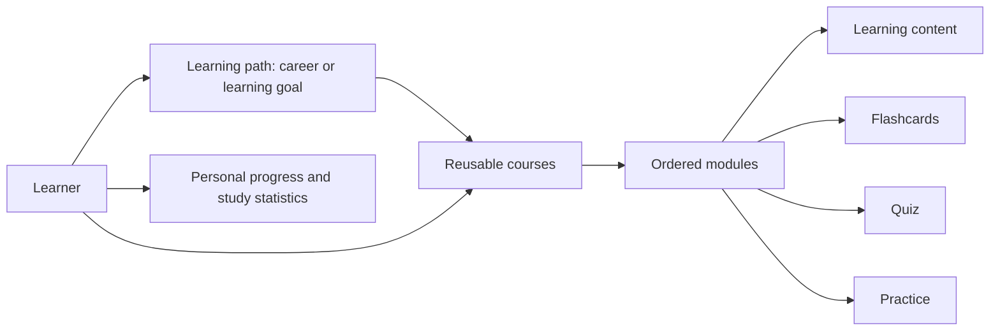

# Coursekind user journeys and UI validation catalog

Last reviewed: 2026-10-26 against the repaired baseline and its regression suites.

This is the acceptance catalog for the 40 active baseline browser tests; AI-06 is deferred in `frontend/e2e`. It combines the product owner's description with the current screens and code. The intended outcome is that a person can author learning material, combine it into a goal, share it, study it, and see their progress and the usefulness of their contributions.

The 40 baseline journeys below retain their stable IDs; AI-06 records a deferred subscription integration. The journeys have stable IDs so test names, issues, and results can refer to the same behavior. This document defines expectations and current behavior. Implementation availability is separate from execution evidence; see the current audit for measured subflows, unresolved limits, and CI status.

The [26 October baseline audit](audits/2026-10-26/README.md) maps every ID to real rendered evidence and durable tests. The [25 October walkthrough](audits/2026-10-25/README.md) remains unchanged historical evidence. The [AI workspace proposal](ai-workspace-proposal.md) describes deferred follow-on work.

## Product model

| Concept | Meaning |
| --- | --- |
| Course | An independently authored subject, with metadata and an ordered collection of modules. A course can be studied directly or reused in several learning paths. |
| Module | A lesson containing learning content and optional flashcards, a quiz, and practice. Each activity belongs to its module. |
| Learning path | An ordered collection of courses that guides a learner toward a goal, such as becoming a senior software engineer. Its courses supply their modules. |
| Author / path curator | A user who owns a course or path and manages its content and sharing. A person can be both an author and a learner. |
| Learner | A user studying their own or an accessible person's material. Their answers, ratings, progress, and stats belong to them. |
| Selected path | A path a learner chooses to follow. This is a product requirement distinct from owning or authoring a path. |
| Course reuse | Inclusion of an existing course in a path. The current data model stores a reference to the course, preserving its author and modules. |
| AI preference | The user's selected provider and model. Anvil is the default; external providers require the user's credentials. Per-user selection, encrypted credentials and explicit model catalogs are implemented. |

Shared lesson HTML is allowlist-sanitized: scripts, iframes, event handlers, inline styles and unsafe URL protocols do not render. Mermaid uses strict mode with protected configuration and HTML labels disabled; author directives cannot downgrade it. Standard Markdown, tables, code and authenticated local images remain supported.

The current module model supports one quiz and one Python or JavaScript practice sandbox per module. Multiple independent practice activities and non-code practice would need an expanded model.

## How to read the catalog

Implementation labels describe availability, not test results:

- **UI:** A current screen exposes the main flow. Negative cases and all acceptance checks still require verification.
- **UI does not mean Pass:** every baseline journey now has controls, but browser results, integration regressions and external limits are reported separately.

**P0** covers the present core learning loop and access boundaries. **P1** covers the sharing, analytics, and model-choice requirements, plus supporting flows. P1 features must meet their acceptance checks before their release; priority is an implementation order, not permission to ship a broken feature.

Each journey supplies its actor and starting state, the UI actions, visible and persisted outcomes, and an important failure or boundary case. Additional branches remain acceptance requirements even where only the named main scenario is browser automated.

| Area | Journey IDs | Count |
| --- | --- | ---: |
| Accounts and access | AUTH-01–AUTH-03 | 3 |
| Courses | COURSE-01–COURSE-05 | 5 |
| Module authoring | MODULE-01–MODULE-05 | 5 |
| Studying | STUDY-01–STUDY-06 | 6 |
| Learning paths | PATH-01–PATH-05 | 5 |
| Sharing and contribution | SHARE-01–SHARE-05 | 5 |
| Personal statistics | STATS-01–STATS-04 | 4 |
| AI provider and model choice | AI-01–AI-05 | 5 |
| Supporting screens | SUPPORT-01–SUPPORT-02 | 2 |

## Test personas and fixtures

Use isolated, disposable test data rather than the signed-in user's real courses or account. Account credentials and provider keys come from the test environment and must not appear in this document, screenshots, or committed fixtures.

| Fixture | Purpose |
| --- | --- |
| Author A | Owns a private course and a path; can publish and later revoke access when those controls exist. |
| Learner / curator B | Studies A's accessible course and reuses it in B's own path. Owns separate material to check isolation. |
| Unrelated user C | Has no explicit sharing grant. Distinguishes selected-recipient sharing from broad sharing. |
| Signed-out visitor | Exercises login redirects and access boundaries. Public anonymous browsing is a separate policy decision. |
| Optional admin D | Checks access to the existing Admin screen without giving ordinary personas admin privileges. |
| Python Basics | Two modules: Variables and Functions. Include a recognizable paragraph, two flashcards, two quiz questions with known answers/explanations, and Python practice. |
| Software Design | One module with JavaScript practice. A second author's course checks attribution and reuse. |
| Become a senior software engineer | Path containing Python Basics followed by Software Design: two courses and three modules. |
| Activity history | Controlled timestamps and a controllable clock; activity on consecutive days, a gap, and events inside/outside the seven-day window. |
| AI responses | Deterministic valid and invalid provider responses for normal UI tests, plus a separately tagged real Anvil smoke test. |

Repeat applicable module journeys with content-only, flashcards-only, quiz-only, and practice-enabled modules. An omitted optional activity must not make the lesson unusable or leave an empty selectable tab.

## Accounts and access

### AUTH-01 — Create an account

**UI · P0.** Actor: a new visitor at `/register`.

1. Enter a name, a unique email, and a valid password; submit registration.
2. Verify the current automatic sign-in opens Dashboard, then open Settings. Sign out and confirm the new account can sign in again.

**Validate:** Registration creates an account and signs it in, the displayed identity is correct, and a new user has no other person's private courses, paths, or progress. Creation succeeds once; duplicate email, invalid input, and server failure show useful errors without creating duplicate accounts. If account creation succeeds but automatic login fails, recovery must allow a normal login rather than encourage duplicate registration.

### AUTH-02 — Sign in, resume a session, and sign out

**UI · P0.** Actor: an existing user at `/login`.

1. Try incorrect credentials, then valid credentials.
2. Navigate to Courses, reload a protected page, and confirm the same account remains active.
3. Use Logout or Settings → Sign out; revisit a protected URL and use browser Back.

**Validate:** Failed login does not authenticate. Valid login opens the application. Reload preserves a valid session; sign-out and an expired/invalid session require login again. Cached private content must not remain visible after sign-out or leak into a subsequent user's session.

### AUTH-03 — Respect ownership and isolate learner data

**UI · P0.** Actors: A, B, C, and a signed-out visitor; private and accessible fixtures exist.

1. As B/C, visit A's private course, module, editor, and path URLs directly.
2. As B, open an accessible course and attempt author-only actions; compare A's and B's progress.
3. Visit `/admin` as an ordinary user and protected routes while signed out.

**Validate:** Unauthorized content and mutations are denied by the server as well as the UI. Access to a course does not confer authoring rights or access to another learner's answers/stats. Only an admin may use admin functions. Path controls and direct course/module editors enforce ownership; server access checks cover nested content, media, progress, ratings and generation. Account changes cancel and remove private cached queries before the next identity renders.

## Courses

### COURSE-01 — Create a manual course with module outlines

**UI · P0.** Actor: an author on Courses → Create Course (`/courses/new`).

1. Enter title, description, difficulty, and tags; choose manual authoring.
2. Add two module outlines with different titles and descriptions; save the course.
3. Open it from My Courses, reload, and open each module.

**Validate:** Exactly one course and both modules exist in the chosen order. Metadata and descriptions persist. List, detail, and path cards show the actual module count. An empty title blocks saving; repeated clicks or retry after a partial save do not duplicate the course/modules.

### COURSE-02 — Maintain an existing course's outline

**UI · P0.** Actor: its author at `/courses/:courseId/edit`; existing modules contain material.

1. Rename and describe an existing outline, reorder modules, add one, and remove another.
2. Save, reopen the course and editor, and visit a path that references it.
3. Simulate a module-save failure and retry without leaving the editor.

**Validate:** Saved order matches learning navigation. Renaming/reordering preserves existing lesson content, cards, quiz, and practice. Added and removed modules persist correctly, counts refresh in previously opened views, and retry reuses successful saves. A failure is visible and does not report full success or remove unrelated modules.

### COURSE-03 — Edit course details and delete an owned course

**UI · P0.** Actor: its author at `/courses/:courseId`.

1. Change metadata through Edit; save and reopen from My Courses.
2. Open Delete, cancel it, and verify the course remains.
3. Confirm deletion of a disposable, unreferenced course.

**Validate:** Metadata changes survive reload and appear on cards. Cancel has no effect. Confirmed deletion removes the course from lists and its old URL fails gracefully. Another user cannot edit/delete it. Deletion of a course already used in another person's path is covered separately by SHARE-04 and policy D2.

### COURSE-04 — Discover and open accessible courses

**UI · P0.** Actor: a learner at Courses → Discover (`/courses?tab=discover`).

1. Search by a fixture title; filter difficulty and change Most Popular / Newest / A–Z sorting.
2. Open a result, inspect author and module information, then return.
3. Search for no matches and clear the filters.

**Validate:** Results match the chosen filters/order; no private or unlisted course appears in public discovery. Empty results explain what to do. Cards lead to the correct course and show accurate attribution/counts. Most Popular currently uses `times_added`, not the number of people who studied. Cross-account selection uses SHARE-01; pagination beyond the initial results also needs coverage if the library grows.

### COURSE-05 — Plan a course with AI assistance

**UI · P0.** Actor: an author creating/editing an AI-assisted course; Anvil is available.

1. Enable AI assistance and provide purpose, target audience, learning objectives, tone, and optional context.
2. Generate module suggestions; inspect and select suggestions, edit titles/descriptions, and choose append or replace as offered.
3. Optionally generate content for the selected modules, then save and reopen.

**Validate:** Instructions persist and inform the request. Selected outlines become real editable modules in the chosen order; unselected suggestions do not. Replacement changes the intended outline only. Generated content survives reload, counts refresh, and pending/error states preserve the draft. Saved provider-choice behavior is specified in AI-02–AI-05.

## Module authoring

### MODULE-01 — Write and maintain lesson content

**UI · P0.** Actor: an author using Add Module or a module's Edit screen.

1. Enter a title and Markdown containing headings, a list, a table, a link, and code; inspect the preview.
2. Save, open the learner view, reload, and edit again.
3. Change only the content and save a second time.

**Validate:** Rendered structure and source correspond, existing activities remain intact, and the module appears once in its course. A content-only module is usable. Missing required fields and failed saves retain the draft and show errors. The editor's practice tab is named Sandbox; the learner tab is Practice.

### MODULE-02 — Author a flashcard deck inside a module

**UI · P0.** Actor: a module's author on its Flashcards editor tab.

1. Add two distinguishable front/back pairs; edit, reorder, and remove a disposable card.
2. Save and reopen both editor and learner Flashcards tabs.

**Validate:** The saved fronts/backs and order match the editor; the tab/card count matches the actual deck. Editing cards does not change the lesson, quiz, or sandbox. Empty or incomplete cards produce a clear validation result rather than silently corrupting the deck. Stable card IDs retain ratings through reordering; replacement uses a new identity as specified in D8.

### MODULE-03 — Author a quiz and answer key

**UI · P0.** Actor: a module's author on its Quiz editor tab.

1. Add two questions, answer options, one correct option per question, and explanations.
2. Edit/remove questions and options, save, and reopen the learner quiz.

**Validate:** Questions, options, correct answers, and explanations persist with the correct question. Known answers score correctly. Removing an option cannot leave an out-of-range answer index. Empty questions, invalid option counts, and missing/invalid answer keys have explicit validation outcomes; server validation must agree with the editor.

### MODULE-04 — Configure and remove practice

**UI · P0.** Actor: a module's author on Sandbox.

1. Enable Python practice; enter instructions, starter code, and a solution; run the test and save.
2. Reload, change the code, save again, and repeat with a JavaScript fixture.
3. Remove the sandbox, save, reload, and navigate between editors for different modules.

**Validate:** Language, instructions, starter code, and solution survive creation and later edits. Output belongs to the latest execution. Explicit removal persists and hides the learner Practice tab. Opening another module never carries over the previous module's sandbox draft. Untouched existing practice survives edits to other tabs.

### MODULE-05 — Generate and refine module activities with AI

**UI · P0.** Actor: a module author with saved course instructions and working AI.

1. Generate lesson content with selected flashcard/question quantities, then inspect the result.
2. Generate flashcards or a quiz separately; exercise the offered flashcard append/replace/cancel choices.
3. Manually refine generated material, save, and reopen the learner view.

**Validate:** Returned material is structured, nonempty, relevant to the module, and editable. Requested quantities either match or a clear discrepancy is reported. Append/replace affects the intended activity, cancellation preserves existing content, and saved edits persist. Malformed, empty, or failed generation never masquerades as a successful save. Image generation is explicitly unavailable in this baseline; text success does not validate images.

## Studying modules

### STUDY-01 — Read a lesson and run embedded examples

**UI · P0.** Actor: a learner entering a module from its course.

1. Read Content, follow rendered structure, and run an embedded Python or JavaScript example where provided.
2. Change a value and rerun; test a controlled syntax/runtime error.
3. Return to course progress and Recent Activity.

**Validate:** The correct lesson renders and optional tabs reflect available activities. A known `2 + 3` example prints `5`; a changed example produces changed output without stale output accumulation. Errors are readable and the lesson remains usable. Content-read progress belongs to this learner. Reading requires the explicit Mark content read action; loading or refreshing a page does not qualify as study.

### STUDY-02 — Review every flashcard, including the last

**UI · P0.** Actor: a learner on Flashcards with a two-card fixture.

1. Flip the first card, move forward/back, and flip the final card.
2. Finish or move to the next module; return to the course summary and reload.
3. Repeat a study visit and review cards again.

**Validate:** Front/back and navigation boundaries are correct. The last card is recorded without needing a nonexistent next card. Duplicate interactions during the same visit do not double-count the same review. Completion waits for pending review saves; a failed save leaves a useful retry state. The displayed deck progress never exceeds deck size even though repeat-study history may grow. Distinct current-card progress persists across visits; append-only review events retain repeat-study history independently (D8).

### STUDY-03 — Rate cards and focus on difficulty

**UI · P0.** Actor: a learner on a module's Flashcards tab.

1. Rate different cards Easy, Medium, Hard, and Unhelpful.
2. Switch among All, Unrated, and rating filters; change a rating and reload.

**Validate:** Ratings persist for that user/card and do not affect another learner. Filters contain only the matching cards, reset navigation safely, and show an understandable empty state. A rating also records the review once for the visit. Never describe this as validated spaced repetition: scheduled due dates and a scheduling algorithm are separate from the visible rating/filter flow.

### STUDY-04 — Take a quiz, learn from mistakes, and retry

**UI · P0.** Actor: a learner on Quiz with a known two-question fixture.

1. Leave a question unanswered, then answer both with one correct and one incorrect.
2. Submit; inspect score, answer feedback, and explanations.
3. Retry with both correct, then return to course progress and reload.
4. If offered, generate more questions and answer the expanded set.

**Validate:** Submission requires all answers; fixture scores are 50% and 100%. Feedback identifies the correct answers and explanations. Retry clears the previous attempt's local answers and adds a new persisted attempt on submission. The stored summary currently uses the latest score, not the best score. Extra learner-generated questions and quiz attempt history persist privately, without modifying the authored quiz (D8). Failed progress saves must not present a successfully persisted result without an error.

### STUDY-05 — Practice with starter code, feedback, and a solution

**UI · P0.** Actor: a learner on Practice; repeat for Python and JavaScript.

1. Read instructions, modify starter code, and Run; rerun with a different value and a controlled error.
2. Reset to starter code; reveal/hide the solution when one exists.
3. Leave and return to the lesson.

**Validate:** Output/errors correspond to the current execution; reset and solution controls behave as labeled. Executed code cannot alter another learner's data. Long-running code has a bounded failure/recovery path; this requires explicit validation, especially for Python. A run records a personal practice event and result, not a passed assessment. Draft code, run history and explicit Reset persist for that learner (D8). Python and JavaScript run in terminable workers with a five-second execution bound; Python CDN startup has a separate 30-second bound. Workers are not a network security boundary.

### STUDY-06 — Complete modules and resume the course

**UI · P0.** Actor: a learner in a two-module course.

1. Study the first module, use Next, and verify the second module opens in saved order.
2. Use Finish on the last module; inspect course progress and Dashboard, then reload/sign in again.
3. Visit an unfinished module through Continue Learning.

**Validate:** Next/Finish save completion before navigation, including pending card reviews. One completed module displays 1/2 (50%); both display 2/2 (100%). Completion persists, correct modules receive credit, and a failed save does not navigate as though it succeeded. Continue Learning opens an appropriate unfinished module. Current completion is explicit Next/Finish; a passing quiz or completed practice is not currently a prerequisite.

## Learning paths

### PATH-01 — Create and edit a goal-based path

**UI · P0.** Actor: a curator on Paths (`/paths`).

1. Create a path named Become a senior software engineer with description, difficulty, and estimated hours.
2. Open the path, Edit its details, save, and reload.

**Validate:** Exactly one path appears in My Learning Paths with the saved goal/details. An empty path shows Add First Course and a count of zero. Invalid titles/hours and failed saves have clear outcomes; cancellation leaves stored data unchanged. Ownership and learner selection are separate concepts.

### PATH-02 — Build a path from existing courses

**UI · P0.** Actor: a curator with a path and accessible courses.

1. From path detail, Add Course and select an owned course plus another author's accessible course.
2. Also exercise Discover → Add to Path and select an existing path.
3. Attempt to add the same course again and reload the path.

**Validate:** The path holds two course references, not duplicated course copies. Cards show author and actual module counts; clicking reaches the original course and its modules. A duplicate add changes neither membership nor reuse counts. Inaccessible courses are unavailable/denied. If the learner has no path, the picker guides them to create one. The path's current model includes whole courses; choosing individual modules within a path is D1.

### PATH-03 — Reorder, remove courses, and delete a path

**UI · P0.** Actor: a path owner with two courses.

1. Reorder the courses and reload; the learning sequence should follow the saved order.
2. Cancel Remove, then confirm removal of one course.
3. Cancel Delete, then confirm deletion of the disposable path.

**Validate:** Reordering changes sequence only. Removal updates membership/counts and leaves the source course and learner progress intact. Deleting a path leaves its courses intact and updates course reuse counts. Mutations are owner-only. Labeled Move up/down buttons persist ordering and support keyboard operation, including unavailable references.

### PATH-04 — Select and follow someone else's path

**UI · P1.** Actor: B viewing an accessible path authored by A.

1. Discover/open the shared path, inspect its goal and courses, and choose to follow/select it.
2. Open B's selected-path list/Dashboard, reload, and start studying.
3. Unfollow the path and confirm its selection count changes.

**Validate:** Selection is stored once for B, survives reload, and is distinct from ownership. B keeps independent progress and does not gain edit rights. Repeated selection is idempotent. Unfollowing removes B's selection without deleting A's path or B's underlying course progress. My Paths, Public & shared paths, and Following are separate URL-backed collections. Follow/unfollow persists independently of authorship.

### PATH-05 — Learn through a path and keep summaries accurate

**UI · P0.** Actor: a learner following the two-course/three-module fixture.

1. Enter a course from the path and study its modules in course order; continue into the next course.
2. Inspect course and path completion; finish all three modules and reopen the path.
3. As the author, add/remove a module, then revisit the previously opened path/course views.

**Validate:** Progress is personal, persistent, bounded by 100%, and calculated from real membership. Course cards use 0 modules / 1 module / 2 modules correctly and refresh after manual, outline, batch, or generated module changes. Dashboard Continue Learning recommends unfinished modules from followed paths and directly studied courses. Each path course has equal weight using its module completion percentage; empty/unavailable references contribute zero (D5). One of two modules in the first of two courses yields 25%.

## Sharing and contribution

### SHARE-01 — Choose course visibility and let another user study it

**UI · P1.** Actors: A authoring; B/C receiving or discovering.

1. A changes an owned course from private to a supported share mode.
2. B opens the course through its shared link or Discover, studies it, and adds it to B's path.
3. A switches visibility again; repeat checks as B/C.

**Validate:** Private material stays author-only; unlisted is excluded from discovery; public material is discoverable according to the access policy. Attribution remains A's. Recipients can study and reuse only within their granted rights. The owner Sharing panel saves private/unlisted/public visibility. Named-recipient sharing uses SHARE-02; an unlisted link requires a signed-in account.

### SHARE-02 — Share a course with specific people and revoke access

**UI · P1.** Actors: A grants access to B; C is unrelated.

1. A selects B as a recipient through an in-app sharing control.
2. B opens the course; C tries the same direct URL and Discover.
3. A revokes B's grant; B revisits from an open tab, bookmarked link, and an existing path.

**Validate:** Only intended recipients receive access, grants persist, and repeated grants do not duplicate entries. Revocation is enforced on subsequent server requests and stale UI refreshes. Learning access does not confer authoring rights. The Sharing panel grants/revokes registered recipients by email without a public account directory. Recipients receive study/reuse access only (D2).

### SHARE-03 — Share a learning path inside the product

**UI · P1.** Actors: A shares a path; B opens it and selects it.

1. A sets a sharing audience and obtains a link or in-app shared entry.
2. B views the goal, course sequence, authors, and module counts; then follows the path.
3. C attempts access; A revokes sharing and B revisits.

**Validate:** Path visibility and membership behave as configured, and B's progress remains independent. Sharing a path does not automatically grant access to private courses inside it. A blocked course has understandable unavailable/access messaging rather than quietly making a complete path look shorter. Owners have path visibility/recipient controls. Public & shared paths supports discovery and following; inaccessible references remain generic placeholders without private titles or counts.

### SHARE-04 — Handle edits, deletion, and revoked course access in reused paths

**UI · P1.** Actors: A owns a course referenced in B's path.

1. A edits module content or adds/reorders modules; B reopens the path/course.
2. A makes the course inaccessible or deletes it; B refreshes an already open path and lesson.
3. Attempt access through direct module, generation, and progress requests as B/C.

**Validate:** Live course references reflect allowed author edits and retain attribution. Access rules apply at every entry point, including nested modules; stale browser state does not grant access. Unavailable course references and their effect on completion are explained, with a way for B to remove/replace the course. Source deletion is allowed and retains a generic unavailable reference in existing paths (D2). Do not silently turn live reuse into an editable copy.

### SHARE-05 — Show authors how useful their courses are

**UI · P1.** Actor: A viewing contribution statistics; B/C curate paths.

1. B adds A's course to one path, repeats the add, then adds it to a second path; C adds it to another.
2. A inspects course-level usage and any personal contribution summary.
3. B removes a course reference, deletes a path, and re-adds the course.

**Validate:** Using the adopted active-reference rule in D4, counts move 0 → 1 → 1 → 2 → 3; removal/deletion decrements once and never below zero. Reordering, studying, refreshing, and following an existing path do not create new course-to-path references. The count's unit and inclusion of the author's own paths are labeled. A receives aggregate usefulness information without unauthorized details about private recipient paths. Course cards/detail show derived total, author-owned and other-owner active path references; service/concurrency regressions verify reconciliation.

## Personal statistics

### STATS-01 — See how often I studied in the last week

**UI · P1.** Actor: a learner with controlled activity history.

1. Study content, review cards, take a quiz, and practice during defined sessions.
2. Return to Dashboard and inspect the last-seven-days measure; reload.
3. Advance the test clock beyond the window and include same-session repeated actions.

**Validate:** The displayed session count uses D3's agreed session/timezone/window rule, excludes events outside the window, and does not count page refreshes as new sessions. A zero-activity user sees zero. Dashboard shows Study Sessions · Last 7 Days from meaningful activity history, independently of module completions and accumulated active study time. A session splits after more than 30 minutes of inactivity.

### STATS-02 — Maintain current and longest study streaks

**UI · P1.** Actor: a learner; clock and qualifying study events are controlled.

1. Study on consecutive days, repeatedly on the same day, and on both sides of local midnight.
2. Leave a day with no study, return, and resume studying.
3. Restudy the same module on later days; reload and inspect current/longest streak.

**Validate:** Same-day activity adds no extra streak day. A missed day breaks the current streak under D3's boundary rule; the longest streak remains the historical maximum. Repeated study of one module preserves every qualifying day's history. Streaks use append-only qualifying event dates in the user IANA timezone (UTC default), retaining same-module history and the historical maximum. Legacy progress without event history cannot reconstruct missing past dates.

### STATS-03 — See courses in progress and paths I selected

**UI · P0.** Actor: a learner with not-started, started, and completed fixtures.

1. Start a course without completing a module, complete one module, then finish the course.
2. Select two paths, finish one, and unfollow the other.
3. Reuse the same course across two paths; compare Dashboard and course/path lists.

**Validate:** Under D5, started-but-unfinished courses count once, including before the first module completion; completed courses leave In Progress. Selected paths count the learner's selections and have a separately named active/completed breakdown. Reused courses do not inflate the distinct-course count. Courses In Progress includes meaningful starts before any module completion. Selected Paths, Active Selected Paths and Completed Selected Paths count follows independently of owned paths.

### STATS-04 — See activity and progress that survive navigation

**UI · P0.** Actor: a learner after content reading, card review, quiz submission, and completion.

1. Perform each activity, then visit Dashboard, the course summary, and the module.
2. Reload, sign out/in, and repeat as a second user.

**Validate:** Recent Activity shows the correct activity label, course/module, time, and quiz score when relevant. Flashcard review events render without breaking the dashboard. Summary percentages, deck counts, quiz attempt counts/latest score, and completed states agree with saved state and remain personal. No missing optional activity causes a broken feed. Weekly sessions, streak history, and path adoption still require the dedicated journeys above.

## AI provider and model choice

### AI-01 — Use Anvil by default without a personal key

**UI · P0.** Actor: a newly registered user with no provider credentials.

1. Open Settings → AI Assistant and inspect connection status and model.
2. Generate a course outline or module activity and save the result.
3. Repeat with Anvil unconfigured or temporarily unreachable in an isolated test environment.

**Validate:** The default is Anvil's configured route, currently `llm.primary` locally. The user supplies no personal key; the server credential is never returned. Successful generation yields usable content. Connected, Unreachable, Not configured, and failure states are truthful and give useful recovery guidance; the user's draft remains intact.

### AI-02 — Choose among available Anvil models

**UI · P1.** Actor: a learner/author on Settings → AI Assistant.

1. View available hosted routes, choose `llm.primary` or `llm.secondary` when offered, and save.
2. Reload/sign in again, then generate an outline, content, cards, and quiz.
3. Switch back or select a route that becomes unavailable.

**Validate:** The user's choice persists independently of other users and the actual server requests use that route. Display names map to real configured model IDs; a configured route is not assumed available merely because its name is familiar. Unknown/unavailable routes show an explicit recovery choice. Settings saves per-user provider/model preferences and shows advertised hosted text routes. Availability is checked through the catalog and actual generation.

### AI-03 — Bring a key and choose an external provider/model

**UI · P1.** Actor: a user choosing an external option, including OpenAI/Codex, Gemini, or Claude as requested.

1. Choose a provider, enter that provider's own API credential, validate it, and choose an available model.
2. Save the preference, reload, and generate an outline and module activities.
3. Repeat with missing/invalid credentials and an unavailable model.

**Validate:** External generation requires the selected provider's credential, and requests use that user's provider/model. The UI explains what is configured, masks the credential after saving, and reports validation failures without losing course work. Another user cannot use/view it. OpenAI/Codex means models accessed through the OpenAI API with the user’s API key. A ChatGPT/Codex subscription does not supply that credential (D6).

### AI-04 — Replace or remove my provider credential and return to Anvil

**UI · P1.** Actor: a user with an external provider configured.

1. Replace the credential and confirm later requests use the replacement.
2. Remove it; revisit Settings after reload and a new login.
3. Choose Anvil and generate again without a personal key.

**Validate:** Removed keys are no longer usable by the application, responses never echo secrets, and another account remains unaffected. Credentials are protected server-side and excluded from browser persistence, URLs, logs, traces, screenshots, and exports. Removing the active key requires an explicit valid provider choice or clear default-state explanation. The active Settings flow uses encrypted server-side credentials, masks returned values, and requires explicit provider/model selection after removal.

### AI-05 — Handle generation errors, limits, and provider changes

**UI · P0 for current Anvil / P1 for provider choice.** Actor: an author with an unsaved draft.

1. Exercise timeout, rate limit, unavailable model, invalid key, malformed/empty result, and insufficient application-token balance where applicable.
2. Correct the issue and retry once; change providers between separate generation requests.

**Validate:** A pending request prevents accidental duplicate submission and has a recoverable error state. The draft and previously saved content survive. Retries do not duplicate modules or charges. The UI identifies the provider/model used and does not silently send material to another provider. Request routing, cancellation/in-flight preference changes, and any charging/refund rules need explicit tests under D6/D7. Protocol-shaped fake HTTP tests cover all four adapters; real primary Anvil generation is separately evidenced. Successful Anvil artifacts debit application accounting credits exactly once; BYOK success records zero application-credit debit. These are local usage units, not external inference spending.

### AI-06 — Deferred local Codex subscription

**Status: unavailable, not an executable baseline journey.** The CLI prototype failed its required host instruction/tool isolation qualification and was removed from the selectable execution paths. Historical successful generation and 41-case CI runs remain evidence of that prototype only.

Stored subscription choices must show a retired/unavailable selection and block generation until the user explicitly chooses and saves another provider/model. Anvil remains the default; no silent rerouting occurs. A future subscription integration needs separately qualified isolation. See the [retirement and historical diagnostic](local-codex-subscription.md).

## Supporting screens

### SUPPORT-01 — Set notification preferences

**UI · P1.** Actor: a user on Settings → Notifications.

1. Change email/daily-quiz preferences, save a valid phone number if wanted, and reload.
2. Verify the preferences belong only to the current user; exercise invalid input and save failures.

**Validate:** The visible state agrees with saved preferences and enabled delivery choices. Test Email/SMS and scheduled delivery require separate opt-in tests using a captured/local delivery adapter; ordinary UI suites must not send real messages. Provider availability and delivery success are separate from successfully saving preferences.

### SUPPORT-02 — Navigate, recover from errors, and use the app on mobile/keyboard

**UI · P0.** Actor: any authenticated persona, with empty and populated accounts.

1. Use Dashboard, Paths, Courses, Settings, breadcrumbs/back links, and mobile navigation; exercise browser Back/Forward and direct links.
2. Use keyboard-only form/dialog/tab interactions, including focus and the skip link.
3. Exercise an empty library, missing/deleted URL, slow request, and recoverable server error.

**Validate:** Correct page identity, understandable loading/empty/error states, accessible names, visible focus, usable dialogs, and recovery actions. No blank page, framework overlay, relevant uncaught console error, inaccessible primary action, or clipped required control at desktop/mobile widths. Each journey must reach a visibly verified outcome rather than stopping at a successful click or HTTP response.

## Adopted baseline policies

These working policies were adopted for the 26 October baseline repair. They preserve existing interfaces and defer naming, product redesign, groups and collaboration editing.

| ID | Topic | Implemented rule |
| --- | --- | --- |
| D1 | Path composition and adoption | Ordered live whole-course references; no per-module selection. Following is an idempotent per-user relationship separate from ownership. |
| D2 | Sharing and lifecycle | Authenticated public/unlisted access; private owner or named registered recipient by email. Study/reuse only for recipients. Paths do not grant course access. Revocation applies on subsequent server requests; deleted/revoked sources remain generic unavailable path references. Source edits remain live; source deletion never creates a copy. |
| D3 | Events, sessions and streaks | Explicit read, card review, quiz submission, practice run and completion qualify. Passive load/start does not. Consecutive events separated by more than 30 minutes begin another session; rolling seven-day counts include sessions with in-window activity. User IANA timezone, UTC default. One streak day per local date; yesterday remains current until today ends; retain historical longest. |
| D4 | Contributions | Distinct active path-course references, derived from membership. One count per path; removal/deletion reconciles. Show author-owned and other-owner path totals. Followers and study actions do not increase this unit. No private recipient-path details exposed. |
| D5 | Progress | Meaningfully started but unfinished distinct courses count In Progress. Selected paths are all accessible follows with active/completed subsets. Each course has equal path weight using module completion; empty/unavailable courses contribute zero. Completion remains explicit Next/Finish. Stable module IDs retain progress across content edits. |
| D6 | AI selection | Default Anvil configured text route; actual advertised hosted catalog. Per-user Anvil/OpenAI/Gemini/Anthropic selection; external provider API key required. OpenAI/Codex is OpenAI API access, not subscription OAuth. Snapshot provider/model during each operation; never silently fallback. Image generation is unavailable. |
| D7 | AI accounting | Anvil credits measure local application usage for future limits/chargebacks: outline 10, full module 25, flashcards 8, quiz 10. Check funds before inference and finalize artifact/debit atomically exactly once. Failed/invalid operations do not charge. Successful BYOK usage is recorded with zero app-credit debit; external provider bills its key holder. |
| D8 | Personal learning state | Stable card IDs survive edit/reorder, new replacement IDs receive no old credit. Current deck progress counts distinct extant reviewed IDs; repeat events remain history. Extra quiz questions, attempts, practice code and runs are personal and persistent. Reset explicitly saves starter code. Legacy aggregates cannot recreate missing card identities or historical dates. |

## Durable browser test suite

### Common acceptance checks

For each journey, cover the normal path, the most important failure/access case, and persistence after reload or a fresh session. Mutation success requires both the correct visible state and saved data; read API/storage state as a secondary check without replacing the real UI actions. Also check previously visited pages for stale counts and summaries after navigation.

Use semantic labels/roles and stable test IDs where necessary. Avoid selectors based on card order, CSS classes, arbitrary sleeps, or generated prose. Scope controls to the intended course/module. Assert known fixture IDs/counts/answers; verify AI response structure and requested quantities rather than exact free-form wording.

Use separate browser contexts for A/B/C and signed-out scenarios, isolated fixture namespaces per run, controlled time for statistics, and disposable storage. Never delete existing local user material during cleanup. Keep provider credentials and auth tokens out of test artifacts; use synthetic secrets in mocked tests and environment-managed secrets for explicitly tagged integrations.

### Browser scenarios and companion regressions

| Suite | Journeys | Observable end state |
| --- | --- | --- |
| `accounts-and-access` | AUTH-01–AUTH-03 | Correct identity, persistent valid session, effective sign-out, denied unauthorized access. |
| `course-authoring` | COURSE-01–COURSE-05 | Saved course with accurate metadata, ordered modules, usable discovery, and editable AI suggestions. |
| `module-authoring` | MODULE-01–MODULE-05 | Source/editor/learner content agree; cards, quiz, and sandbox survive saves/removal. |
| `study-loop` | STUDY-01–STUDY-06 | Visible study results, saved personal activity, complete course, useful resume behavior. |
| `path-curation-and-learning` | PATH-01–PATH-05 | Accurate course membership/order/counts and independent learner adoption/progress. |
| `sharing-and-contributions` | SHARE-01–SHARE-05 | Real cross-account access/revocation, preserved authorship, correct reuse accounting. |
| `personal-statistics` | STATS-01–STATS-04 | Reproducible session, streak, selection, progress, and activity totals. |
| `ai-preferences` | AI-01–AI-05 | Default Anvil works; saved choice routes requests correctly; credentials/failures handled. |
| `settings-and-navigation` | SUPPORT-01–SUPPORT-02 | Persistent settings, accessible navigation, useful empty/error states on desktop/mobile. |

The [Playwright suite](../frontend/e2e/README.md) has one named test per ID across four files. It uses real HTTP routes and disposable storage, with mocked provider HTTP and captured notification transports. The [current audit matrix](audits/2026-10-26/README.md) identifies scenario scope, companion negative-case regressions and external limits. Real Anvil evidence remains separate from deterministic CI.

### Result tracking and release rule

Use a row per journey/scenario with: **journey ID, scenario, implementation state, test file/name, result, environment/commit, date, evidence, and issue/blocker**. Results are Pass, Fail, Not run, or Blocked. A missing feature is an explicit blocker, never a passing skipped test. A journey passes only when all required scenarios for that release pass. Record visual/manual evidence separately from automated browser results.

The frontend includes Vitest/Testing Library plus `npm run test:e2e`, `test:e2e:list` and `test:e2e:types`. GitHub Actions runs the complete browser suite and uploads per-journey wall times, failures, screenshots and traces. The existing [tailnet E2E script](../scripts/e2e-tailnet.py) exercises HTTP registration/login, Anvil health/generation, and persistence. It does not drive UI controls and cannot certify this catalog's browser coverage.

## Evidence and known coverage limits

The [current audit](audits/2026-10-26/README.md) preserves raw browser facts, adds a normalized per-subflow timing log, maps failures to explicit repairs/retests, and links durable browser scenarios plus unit/integration boundaries. Real Anvil primary outline → module → cards/quiz → manual edit/save/reload passed on the disposable fixture. External OpenAI/Gemini/Anthropic results use mocked HTTP; no vendor availability or billing claim follows from them. Captured notification delivery does not certify production delivery.

Python runs were exercised through actual rendered UI, including timeout/error/recovery. Automated browser execution uses JavaScript workers to avoid a CDN dependency; Python runtime installation remains an external integration. Mobile evidence includes actual 390 CSS-pixel geometry and keyboard actions; the local in-app screenshot compositor did not reliably reflect viewport emulation, so those screenshots do not certify a phone rendering.

The historical [25 October audit](audits/2026-10-25/README.md) is unchanged. Neither historical main-flow completion nor a passing named browser scenario certifies every acceptance branch. Report pending CI and null timings honestly; do not infer pass or zero time from missing evidence.

## Source references

- [Application routes and navigation](../frontend/src/App.tsx)
- [Course list/discovery](../frontend/src/pages/Courses.tsx), [course editor](../frontend/src/pages/CourseEditor.tsx), and [course model](../backend/models/course.py)
- [Module editor](../frontend/src/pages/ModuleEditor.tsx), [learner view](../frontend/src/pages/ModuleViewer.tsx), and [module model](../backend/models/module.py)
- [Paths list](../frontend/src/pages/LearningPaths.tsx), [path detail](../frontend/src/pages/LearningPathDetail.tsx), and [path service](../backend/services/learning_path_service.py)
- [Progress/stats service](../backend/services/progress_service.py) and [Dashboard](../frontend/src/pages/Dashboard.tsx)
- [Settings UI](../frontend/src/pages/Settings.tsx) and [current AI settings endpoint](../backend/api/routes/user_settings.py)

## Follow-on product work

The product owner also requested a subsequent discussion of making the workflow more AI-driven, choosing a new product name, and planning a relaunch. Use this catalog as the functional baseline for that work. Naming, branding, expanded AI workflows, and relaunch implementation are not specified here; update the affected journey IDs as those decisions are made.

## Whole-branch regression contracts (26 October 2026)

Course outlines compare the editor's initial module snapshot inside one server transaction. A concurrent addition, deletion or edit returns a conflict with the local draft retained; retrying the identical successful request never duplicates modules. Counts read current committed membership, including generation.

Module editors keep all local fields when a changed server response arrives. The author explicitly chooses Reload server version or Keep my draft before saving. Every failed study encounter retains its original event ID until acknowledged; Finish retries unresolved saves and cannot silently discard them. Owners may explicitly follow/unfollow their own paths independently of author controls.

All course/path discovery, details, nested lessons and media require sign-in, including trusted filesystem study content. Uploads accept validated PNG/JPEG/GIF/WebP raster bytes. Legacy SVG bytes remain on disk but are not served or rehosted in browser blobs. Remote image references are browser-rendered without app credentials; server URL downloading is disabled.

## Additive Coursekind workspace journeys (26 October 2026)

The original 40 IDs and D1–D8 above remain unchanged. These are six additional journey groups, with multiple browser cases allowed per group.

| ID | Journey and acceptance |
| --- | --- |
| WORKSPACE-01 | Goal-only brief with visible editable defaults → plan → manual review → apply → one-module draft → apply → study/reload. |
| WORKSPACE-02 | Path with explicitly selected accessible reused courses; original authorship and private-source access remain intact. |
| WORKSPACE-03 | Partial failure, saved draft after reload, restart interruption and explicit selected-step retry; no automatic provider repeat/fallback. Browser partial/retry plus deterministic backend restart tests. |
| WORKSPACE-04 | Scoped revision, readable before/after, stale conflict, history and compensating restore without lost study records. |
| WORKSPACE-05 | Optional explicit Jev disclosure, advisory probabilities, stale/cache/error states, no effect on scores or completion. |
| WORKSPACE-06 | Account switch/sign-out privacy, compact mobile sections, keyboard/zoom/focus recovery, write-gate-off baseline navigation. |

The Task 5 scenario package lists 49 browser cases (40 original plus 9 workspace), not 49 distinct journey groups. The operating guide and audit separate authored scenarios, deterministic passing tests, root CUA evidence, live inference and exact-commit remote CI.

## Ergonomics acceptance follow-up (26 October 2026)

[Journey ergonomics review](audits/2026-10-26-ergonomics/README.md) records observed friction, changes, coverage limits and [measured scenario results](audits/2026-10-26-ergonomics/journey-results.md).

SUPPORT-03 adds phone touch coverage for course browsing → Start learning → each available study activity → path reordering. Primary shared buttons and activity controls have at least 44px targets, study choices remain visible in a two-column phone layout, and controls must fit without page-level horizontal scrolling. STUDY-06 now verifies the course's Continue learning and Review course destinations. COURSE-01 includes visible step names on phones; sharing remains closed until requested. Native-device comfort and human task times require separate observation and are not inferred from automation.
